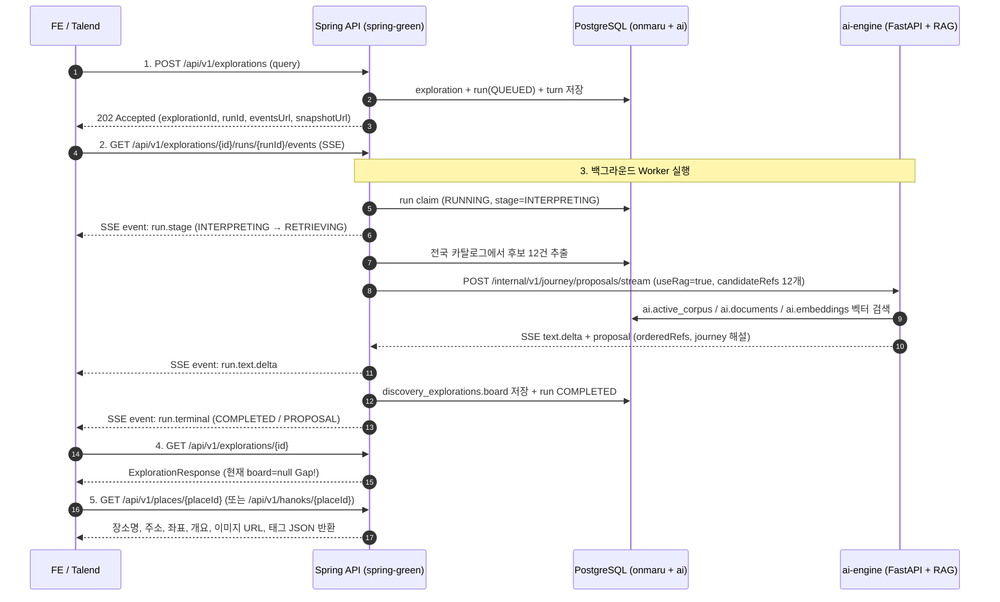

# OnMaru AI 여정 탐색 E2E 데이터 흐름 및 실제 서버 응답 (카나리 실측 기준)

> **기준 실측 대상**: 2026-11-16 운영(`https://api.onmaru.site`) 카나리 실행
> - `explorationId`: `5bc49769-1c5b-4f98-aab3-938aea8b54e6`
> - `runId`: `b4d9f789-83ef-45a6-aa6c-2172118d3a01`
> - 질의(`query`): `"조용한 한옥 코스를 추천해 주세요"` (`regionCode: null` → 전국 검색)
> - 추천 결과(`orderedRefs`): `["p-tourapi-4012448", "p-tourapi-2662883"]` (`engine: LLM`, `outcome: PROPOSAL`)

---

## 0. 핵심 요약: 명소 이미지와 결과가 끝까지 잘 나오는가?

1. **명소 이미지·상세 데이터 자체는 Place/Hanok API에서 정상 출력됨 (단, TourAPI 원본 유무에 따라 갈림)**
   - **추천 1번 `p-tourapi-4012448` (검무한옥 호운당)**: 이미지 URL(`https://tong.visitkorea.or.kr/cms/resource/34/4012434_image2_1.jpg`)이 정상 반환되며, 실제 `GET` 요청 시 **HTTP `200 OK` (`image/jpg`, 105,598 bytes)** 로 로드됩니다. *(참고: TourAPI CDN이 `HEAD` 메서드는 `405`를 반환하므로 브라우저 ``의 `GET` 로드는 정상입니다.)*
   - **추천 2번 `p-tourapi-2662883` (경주 오릉 한옥)**: TourAPI 원본 카탈로그(`catalog_place_image_versions`)에 이미지 자체가 없어 **`images: []` (빈 배열)** 로 내려옵니다.
   - **운영 DB 전체 이미지 보유율 (활성 카탈로그 `23,573`건 실측)**:
     - 전체 장소 `23,573`건 중 이미지 보유 `19,340`건 (**82.0%**)
     - `HANOK_STAY` `498`건 중 이미지 보유 `204`건 (**41.0%**) → 이미지 없는 한옥 숙소가 약 59%이므로 프론트 기본 이미지(placeholder) 처리가 필요합니다.

2. **중요 발견 — 검색 결과(`GET /api/v1/explorations/{id}`)가 아직 `board: null`로 내려감**
   - 백엔드 워커가 LLM+RAG 결과를 DB(`onmaru.discovery_explorations.board`)에 `["p-tourapi-4012448", "p-tourapi-2662883"]`로 **정상 저장**했지만,
   - 스냅샷 조회 핸들러([`ExplorationSnapshotHydrator`](../../apps/spring-api/src/main/java/com/yrootlab/onmaru/web/exploration/ExplorationSnapshotHydrator.java#L28-L60))가 아직 **`INITIAL_BOARD` + `kr-45-jeonju` 하드코딩**만 하이드레이션하고 [`JdbcExplorationStore.find`](../../adapters/persistence-jdbc/src/main/java/com/yrootlab/onmaru/persistence/journey/exploration/JdbcExplorationStore.java#L75-L100)가 `e.board` 컬럼을 읽지 않아, 현재 `GET /api/v1/explorations/{explorationId}` 호출 시 `board: null`이 반환됩니다.
   - 상세 원인은 [Step 5](#step-5-최종-스냅샷-조회-get-apiv1explorationsexplorationid--현재-gap-발견)에 정리했습니다.

---

## 전체 E2E 흐름 요약



---

## Step 1. 첫 검색 요청 (`POST /api/v1/explorations`)

### 클라이언트 요청
- **Endpoint**: `POST https://api.onmaru.site/api/v1/explorations`
- **Headers**:
  - `Content-Type: application/json`
  - `X-CSRF-TOKEN: <CSRF 토큰>`
  - `Idempotency-Key: <UUID>`
  - `Cookie`: `__Host-onmaru-session=...` (로그인 회원)
- **Body**:
```json
{
  "query": "조용한 한옥 코스를 추천해 주세요",
  "locale": "ko-KR"
}
```

### 서버 실제 응답 (`202 Accepted`)
```json
{
  "schemaVersion": "1.2",
  "explorationId": "5bc49769-1c5b-4f98-aab3-938aea8b54e6",
  "runId": "b4d9f789-83ef-45a6-aa6c-2172118d3a01",
  "stateVersion": 0,
  "runUrl": "/api/v1/explorations/5bc49769-1c5b-4f98-aab3-938aea8b54e6/runs/b4d9f789-83ef-45a6-aa6c-2172118d3a01",
  "eventsUrl": "/api/v1/explorations/5bc49769-1c5b-4f98-aab3-938aea8b54e6/runs/b4d9f789-83ef-45a6-aa6c-2172118d3a01/events",
  "snapshotUrl": "/api/v1/explorations/5bc49769-1c5b-4f98-aab3-938aea8b54e6"
}
```

---

## Step 2. 실시간 진행 SSE 스트림 (`GET .../runs/{runId}/events`)

클라이언트가 `eventsUrl`로 `Accept: text/event-stream` 연결을 열면 [`ExplorationRunEventsController`](../../apps/spring-api/src/main/java/com/yrootlab/onmaru/web/exploration/ExplorationRunEventsController.java#L54-L98)와 [`JourneyRunEventBuffer`](../../modules/journey/src/main/java/com/yrootlab/onmaru/journey/events/JourneyRunEventBuffer.java#L29-L90)가 아래 이벤트를 전송합니다.

```text
id: 1
event: run.stage
retry: 15000
data: {"schemaVersion":"1.2","runId":"b4d9f789-83ef-45a6-aa6c-2172118d3a01","sequence":1,"status":"RUNNING","stage":"INTERPRETING"}

id: 2
event: run.stage
retry: 15000
data: {"schemaVersion":"1.2","runId":"b4d9f789-83ef-45a6-aa6c-2172118d3a01","sequence":2,"status":"RUNNING","stage":"RETRIEVING"}

id: 3
event: run.text.delta
retry: 15000
data: {"schemaVersion":"1.2","runId":"b4d9f789-83ef-45a6-aa6c-2172118d3a01","sequence":3,"text":"<AI 스트리밍 텍스트 청크>"}

id: 4
event: run.stage
retry: 15000
data: {"schemaVersion":"1.2","runId":"b4d9f789-83ef-45a6-aa6c-2172118d3a01","sequence":4,"status":"RUNNING","stage":"PERSISTING"}

id: 5
event: run.terminal
retry: 15000
data: {"schemaVersion":"1.2","runId":"b4d9f789-83ef-45a6-aa6c-2172118d3a01","sequence":5,"status":"COMPLETED","outcome":"PROPOSAL"}
```

> **참고**: 15초 이상 유휴 시 `event: heartbeat`가 전송되며, 현재 이벤트 버퍼는 인메모리(`capacity=64`)에 보관되므로 컨테이너 재기동 이후 과거 run의 SSE를 재연결하면 `heartbeat` 1건(`Last-Event-ID` 없을 때) 또는 `reset`(`Last-Event-ID` 있을 때)이 내려갑니다.

---

## Step 3. 백엔드 워커 ↔ `ai-engine` 내부 통신 및 DB 저장 데이터

### 3-1. Spring → `ai-engine` 요청 (`POST /internal/v1/journey/proposals/stream`)
[`JdbcJourneyCandidateProvider`](../../adapters/persistence-jdbc/src/main/java/com/yrootlab/onmaru/persistence/catalog/journey/JdbcJourneyCandidateProvider.java#L27-L35)가 `한옥` 토큰 기반으로 전국 활성 카탈로그에서 상위 **12개 후보 `public_id`** 를 뽑아 아래 요청을 전송합니다.

```json
{
  "schemaVersion": "internal.ai.v1",
  "requestId": "...",
  "runId": "b4d9f789-83ef-45a6-aa6c-2172118d3a01",
  "candidateCount": 12,
  "query": "조용한 한옥 코스를 추천해 주세요",
  "candidateRefs": ["p-tourapi-...", "... (최대 12개)"],
  "useRag": true
}
```

### 3-2. `ai-engine` RAG 근거 문서 (운영 DB `ai.documents`, 코퍼스 `rev-20261115025249` 실측)
`ai-engine`은 `ai.documents` + `ai.embeddings`를 조회해 아래 2개 장소를 최종 선별·추천했습니다.

1. **`p-tourapi-4012448` (검무한옥 호운당)** (`KR-47`, `HANOK_STAY`)
   - 문서 발췌: *"이름처럼 좋은 기운이 머무는 공간인 호운당은 전통 한옥 고유의 아름다움을 바탕으로, 검무가 지닌 정신성과 절제된 공간미를 섬세하게 담아낸 독채 한옥이다. 번잡한 일상에서 잠시 벗어나 조용히 머물며 사색하고..."*
2. **`p-tourapi-2662883` (경주 오릉 한옥)** (`KR-47`, `HANOK_STAY`)
   - 문서 발췌: *"천년고도 경주의 문화재인 오릉 뷰의 고즈넉한 한옥을 즐길 수 있다."*

### 3-3. PostgreSQL에 실제 저장된 결과 (운영 DB 실측)

- **`onmaru.discovery_explorations`**
  - `id`: `5bc49769-1c5b-4f98-aab3-938aea8b54e6`
  - `state_version`: `1`
  - `title`: `"여정 탐색"`
  - `last_user_query_preview`: `"조용한 한옥 코스를 추천해 주세요"`
  - `board` (JSONB 실측값):
    ```json
    {
      "engine": "LLM",
      "outcome": "PROPOSAL",
      "orderedRefs": [
        "p-tourapi-4012448",
        "p-tourapi-2662883"
      ],
      "schemaVersion": "1.2",
      "degradedReason": null
    }
    ```
- **`onmaru.discovery_runs`**
  - `id`: `b4d9f789-83ef-45a6-aa6c-2172118d3a01`
  - `status`: `COMPLETED`, `engine`: `LLM`, `outcome`: `PROPOSAL`, `error_code`: `NULL`
- **`onmaru.discovery_turns`**
  - `query`: `"조용한 한옥 코스를 추천해 주세요"`, `turn_response`: `NULL`
- **`onmaru.discovery_proposals`**: `0 rows` (미저장)

---

## Step 4. 런 단건 상태 조회 (`GET .../runs/{runId}`)

`GET /api/v1/explorations/5bc49769-1c5b-4f98-aab3-938aea8b54e6/runs/b4d9f789-83ef-45a6-aa6c-2172118d3a01` 호출 시 [`ExplorationResponse.RunResponse`](../../apps/spring-api/src/main/java/com/yrootlab/onmaru/web/exploration/ExplorationResponse.java#L60-L92)가 아래 JSON을 반환합니다.

```json
{
  "schemaVersion": "1.2",
  "runId": "b4d9f789-83ef-45a6-aa6c-2172118d3a01",
  "status": "COMPLETED",
  "engine": "LLM",
  "degradedReason": null,
  "stage": null,
  "outcome": "PROPOSAL",
  "clarification": null,
  "retryAfterMs": 0,
  "createdAt": "2026-11-16T07:16:55.282719Z",
  "startedAt": "2026-11-16T07:16:55.765981Z",
  "deadlineAt": "2026-11-16T07:17:15.282719Z",
  "error": null
}
```

---

## Step 5. 최종 스냅샷 조회 (`GET /api/v1/explorations/{explorationId}`) — ⚠️ 현재 Gap 발견

원래 설계상 SSE `run.terminal` 이후 프론트가 `snapshotUrl`(`/api/v1/explorations/5bc49769-1c5b-4f98-aab3-938aea8b54e6`)을 호출해 추천 코스(`board` 또는 `pendingProposal`), 장소 카드, 이미지, 추천 이유를 받아야 합니다.

### 현재 실제 반환 형태 (코드 기준)
[`JdbcExplorationStore.find`](../../adapters/persistence-jdbc/src/main/java/com/yrootlab/onmaru/persistence/journey/exploration/JdbcExplorationStore.java#L75-L100)가 `discovery_explorations.board` 컬럼을 조회하지 않고, [`ExplorationSnapshotHydrator.hydrate`](../../apps/spring-api/src/main/java/com/yrootlab/onmaru/web/exploration/ExplorationSnapshotHydrator.java#L28-L60)가 `outcome == INITIAL_BOARD && regionCode == "kr-45-jeonju"`일 때만 하드코딩된 보드를 만들도록 되어 있어, **현재 `PROPOSAL` 결과에 대해서는 아래와 같이 `board: null`이 반환됩니다.**

```json
{
  "schemaVersion": "1.2",
  "explorationId": "5bc49769-1c5b-4f98-aab3-938aea8b54e6",
  "stateVersion": 1,
  "board": null,
  "pinnedRefs": [],
  "excludedRefs": [],
  "unavailableRefs": [],
  "execution": {
    "dataMode": "LIVE",
    "engine": "LLM",
    "rankingVersion": "pending",
    "datasetRevision": "pending"
  },
  "latestRun": {
    "schemaVersion": "1.2",
    "runId": "b4d9f789-83ef-45a6-aa6c-2172118d3a01",
    "status": "COMPLETED",
    "engine": "LLM",
    "degradedReason": null,
    "stage": null,
    "outcome": "PROPOSAL",
    "clarification": null,
    "retryAfterMs": 0,
    "createdAt": "2026-11-16T07:16:55.282719Z",
    "startedAt": "2026-11-16T07:16:55.765981Z",
    "deadlineAt": "2026-11-16T07:17:15.282719Z",
    "error": null
  },
  "pendingProposal": null,
  "recentHistory": [],
  "updatedAt": "2026-11-16T07:16:55.282719Z"
}
```

### 연결을 완성하기 위해 백엔드에서 추가로 필요한 작업
1. **`JdbcExplorationStore.find`**: `discovery_explorations.board` JSON (`orderedRefs`, `engine`, `outcome`, `degradedReason`)을 함께 읽어 `ExplorationState`/`ExplorationSnapshot`에 포함
2. **`PersistJourneyResultCommand` / `JdbcJourneyResultStore`**: 워커가 AI 응답에서 받은 `narrative`(`journey.title`, `summary`, `narration`, `stops[].reason`, `relaxedConstraints`)도 함께 DB(`board` 또는 `discovery_proposals` / `discovery_turns.turn_response`)에 저장
3. **`ExplorationSnapshotHydrator`**: `PROPOSAL` / `INITIAL_BOARD` 결과의 `orderedRefs` 목록을 `PlaceDetailQueryService`로 일괄 하이드레이션하여 `board.candidates`, `board.resources` (`image`, `location`, `summary`), `board.legs`를 채워 반환

---

## Step 6. 실제 명소 상세 & 이미지 API 응답 (`GET /api/v1/places/{placeId}`, `/api/v1/hanoks/{placeId}`)

아래는 추천된 두 장소 ID에 대해 운영 API(`https://api.onmaru.site`)를 직접 호출해 받은 **실제 응답 JSON** 입니다.

### 6-1. 1순위 추천: `p-tourapi-4012448` (**검무한옥 호운당**) — 이미지 정상 출력 ✅

- **호출**: `GET https://api.onmaru.site/api/v1/places/p-tourapi-4012448`
```json
{
  "schemaVersion": "1.2",
  "placeId": "p-tourapi-4012448",
  "name": "검무한옥 호운당",
  "category": "HANOK_STAY",
  "region": {
    "regionCode": null,
    "name": "경상북도 안동시 풍천면 한옥마을2길 15"
  },
  "address": "경상북도 안동시 풍천면 한옥마을2길 15",
  "coordinates": {
    "lat": 36.5753906069887,
    "lng": 128.511452912204
  },
  "images": [
    {
      "url": "https://tong.visitkorea.or.kr/cms/resource/34/4012434_image2_1.jpg",
      "alt": "검무한옥 호운당"
    }
  ],
  "description": "이름처럼 좋은 기운이 머무는 공간인 호운당은 전통 한옥 고유의 아름다움을 바탕으로, 검무가 지닌 정신성과 절제된 공간미를 섬세하게 담아낸 독채 한옥이다. 번잡한 일상에서 잠시 벗어나 조용히 머물며 사색하고, 바쁘게 흘러가던 시간의 속도를 늦추기에 좋다. 총 26평 규모의 호운당은 방 2개와 화장실 2개로 구성되어 있어 가족 여행은 물론, 커플이나 친구들과 함께하는 소규모 모임에도 편안하게 이용할 수 있다. 프라이빗한 독채 공간으로 구성되어 있어 오롯이 휴식에 집중할 수 있다.",
  "contentTags": [
    "한옥숙박"
  ],
  "savedByMe": false
}
```

- **한옥 전용 상세 (`GET https://api.onmaru.site/api/v1/hanoks/p-tourapi-4012448`)**
  위 필드 외에 `highlights: []`, `mapCard` (`thumbnailUrl`: `"https://tong.visitkorea.or.kr/cms/resource/34/4012434_image2_1.jpg"`), `odiiLinkedCard: null`가 추가로 포함됩니다.

- **실제 이미지 URL 검증 (`GET https://tong.visitkorea.or.kr/cms/resource/34/4012434_image2_1.jpg`)**
  - `HTTP/1.1 200 OK`
  - `Content-Type: image/jpg`
  - `Content-Length: 105598`

---

### 6-2. 2순위 추천: `p-tourapi-2662883` (**경주 오릉 한옥**) — 이미지 없음 (`images: []`) ⚠️

- **호출**: `GET https://api.onmaru.site/api/v1/places/p-tourapi-2662883`
```json
{
  "schemaVersion": "1.2",
  "placeId": "p-tourapi-2662883",
  "name": "경주 오릉 한옥",
  "category": "HANOK_STAY",
  "region": {
    "regionCode": null,
    "name": "경상북도 경주시 국당1길 15-1 (사정동)"
  },
  "address": "경상북도 경주시 국당1길 15-1 (사정동)",
  "coordinates": {
    "lat": 35.8255836465,
    "lng": 129.2075018128
  },
  "images": [],
  "description": "천년고도 경주의 문화재인 오릉 뷰의 고즈넉한 한옥을 즐길 수 있다.",
  "contentTags": [
    "한옥숙박"
  ],
  "savedByMe": false
}
```
- **참고**: DB `catalog_place_image_versions`에 해당 `place_id`의 `origin_img_url` / `small_image_url`이 모두 `NULL`이어서 `images: []`로 응답합니다.
- **참고 2**: 두 장소 모두 `catalog_place_versions.region_id`가 `NULL`인 항목이라 `region.regionCode`가 `null`이고 `region.name`이 주소 문자열로 fallback 되고 있습니다.
