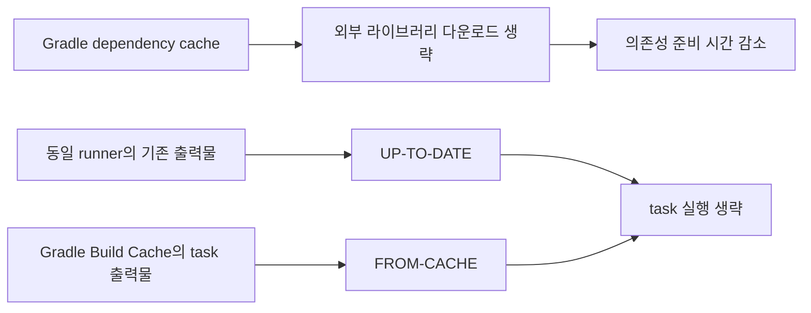
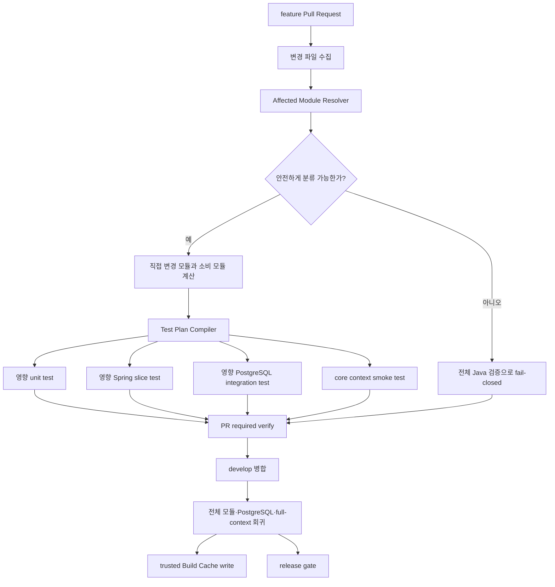
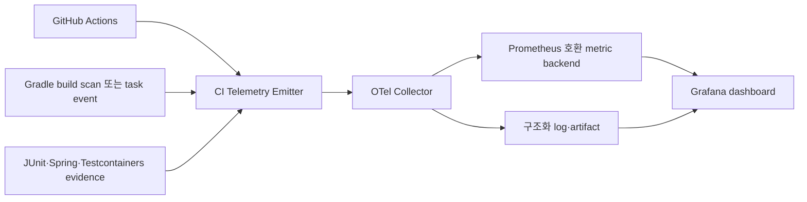
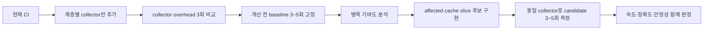

# 멀티모듈의 경계를 CI 실행 경계로 전환하는 PRD

> 상태: 제안
> 관련 Issue: [#867](https://github.com/YRootLab/OnMaru-backend/issues/867)
> 작성일: 2026-11-19
> 대상: OnMaru Backend Java/Spring Boot 멀티모듈 CI

## 이 개선은 CI를 더 많이 병렬화하는 작업이 아니라 불필요한 실행을 제거하는 작업이다

OnMaru Backend는 Gradle 멀티모듈 구조를 사용하지만, 현재 Pull Request CI는 Java 변경이 하나라도 있으면 변경과 무관한 모듈까지 넓게 검증한다. 실제 Java 검증은 최근 실행에서 약 9분 21초부터 17분 25초까지 걸렸으며, 다른 검증 lane이 대부분 1분 이내에 끝나는 것과 비교하면 전체 Pull Request 피드백 시간을 사실상 Java lane 하나가 결정하고 있다.

멀티모듈로 코드를 나누었다는 사실만으로 CI가 변경 영향을 자동으로 이해하지는 않는다. Gradle은 요청받은 task의 의존 관계는 계산하지만, Git diff를 읽어서 어떤 task만 실행해야 하는지는 결정하지 않는다. 여기에 Gradle Build Cache가 비활성화되어 있고 GitHub-hosted runner가 매번 깨끗한 환경에서 시작하므로, 이전 실행에서 얻은 test task 산출물도 다음 실행에서 재사용되지 않는다. 그 결과 현재 구조는 모듈 경계의 개발상 이점은 얻지만, CI 실행 비용을 줄이는 이점은 거의 얻지 못한다.

이 PRD는 Git 변경 파일을 직접 변경된 모듈로 매핑하고, Gradle의 역방향 의존 관계를 따라 소비 모듈까지 계산하는 affected test planner를 정의한다. feature Pull Request에서는 계산된 영향 범위의 unit, Spring slice, PostgreSQL integration test만 필수로 실행한다. 반면 `develop` 병합 이후와 release 승격 단계에서는 전체 회귀 테스트를 유지한다. 빠른 Pull Request 피드백과 최종 안전망의 책임을 분리하되, 선택기가 이해하지 못하는 변경은 전체 검증으로 되돌리는 fail-closed 원칙을 적용한다.

목표는 단일 모듈 feature Pull Request의 필수 CI 중앙값을 현재 대비 40% 이상 줄이고 p95를 8분 이내로 만드는 것이다. 그러나 속도보다 우선하는 기준은 affected 선택의 false negative가 0이어야 한다는 점이다. 선택 실행이 성공했지만 같은 commit의 전체 실행이 실패한다면 이 최적화는 성공한 것이 아니다.

## 현재 구조에서는 모듈이 나뉘어 있어도 검증 단위가 하나로 뭉친다

현재 CI의 Java lane은 Java 관련 경로의 변경 여부만 구분한다. 변경이 감지되면 모듈별 변경 범위와 무관하게 전체 모듈 테스트, Spring API 테스트, 애플리케이션 패키징까지 넓게 수행한다. 이것은 검증 누락에는 보수적이지만, 작은 비즈니스 규칙 변경도 전체 Spring Context와 Testcontainers 기반 PostgreSQL 테스트를 반복하게 만든다.

저장소에는 234개의 테스트 파일이 있으며, 그중 `@SpringBootTest` 사용은 40개, `@AutoConfigureMockMvc` 사용은 37개, Testcontainers 사용은 47개다. 반면 `@WebMvcTest`, `@DataJpaTest`, `@JdbcTest`, `@JsonTest`와 같은 Spring slice annotation은 현재 사용되지 않는다. 특히 Web Boundary 테스트는 이름만 보면 웹 계층 테스트이지만 실제 실행 방식은 `@SpringBootTest + @AutoConfigureMockMvc`이므로 애플리케이션 전체 Context를 올리는 통합 테스트에 가깝다.

기존 Spring API shard 실험에서도 단순한 runner 병렬화만으로는 충분하지 않다는 신호가 확인됐다. unit-contract shard 63개 테스트의 중앙값은 약 158초였지만, postgres-other shard 25개는 약 412초가 걸렸다. 후보 critical path는 직렬 검증 대비 약 12.42% 줄었으나 runner 준비와 fan-out 비용을 포함한 전체 workflow 중앙값은 약 725초였고, 실험 결론은 inconclusive였다. 병목을 여러 runner로 옮기는 것보다 실행할 필요가 없는 테스트를 먼저 제거하고, Spring Context 및 PostgreSQL 초기화 비용을 줄여야 한다.

### Dependency cache와 Build Cache는 서로 다른 문제를 해결한다

현재 Java setup의 Gradle cache는 wrapper, 내려받은 dependency, 일부 Gradle user home 데이터를 재사용하는 데 도움을 준다. 이것은 Maven Central 등에서 같은 artifact를 다시 내려받는 시간을 줄이지만, 이전 runner가 만든 `compileJava`, `test` 같은 task 출력물을 그대로 복원한다는 의미는 아니다.

Gradle의 `UP-TO-DATE`는 같은 작업 디렉터리에 이전 출력물이 남아 있고 입력이 변하지 않았을 때 적용된다. 매번 새 VM에서 시작하는 GitHub-hosted runner에는 그 출력물이 없다. `FROM-CACHE`는 입력 fingerprint가 같은 task 출력물을 Build Cache에서 복원할 때 적용되며, 이를 위해 Build Cache가 활성화되어 있고 이전의 신뢰할 수 있는 실행이 해당 key의 산출물을 저장했어야 한다. 현재 `onmaru.ci.performance.build-cache=false` 설정에서는 이 재사용 경로가 닫혀 있다.

따라서 Gradle cache가 설정되어 있는데 왜 테스트가 매번 도는지에 대한 답은 명확하다. 지금의 cache는 주로 dependency 준비 비용을 줄이고 있으며, task output 재사용은 비활성화되어 있다. 설령 Build Cache를 활성화해도 변경된 공통 classpath가 모든 test task의 입력 fingerprint를 바꾸면 cache miss가 발생한다. Build Cache와 affected test 선택은 대체 관계가 아니라 함께 적용해야 하는 보완 관계다.

## 목표 구조는 Pull Request의 빠른 증명과 통합 브랜치의 전체 증명을 분리한다

feature Pull Request는 변경된 코드가 영향을 주는 범위에서 빠르고 설명 가능한 증거를 제공해야 한다. `develop`과 release는 여러 변경이 합쳐진 전체 시스템이 여전히 동작한다는 증거를 제공해야 한다. 두 단계에 같은 테스트 집합을 반복하는 대신 각 단계의 책임을 분리한다.

feature Pull Request에서 통합 테스트를 전부 없애지는 않는다. 변경된 persistence adapter가 PostgreSQL 동작에 영향을 준다면 관련 Testcontainers 테스트는 반드시 실행한다. 다만 변경과 무관한 catalog, audio 또는 다른 도메인의 컨테이너 테스트까지 모두 반복하지 않는다. Flyway migration, 보안 설정, 공통 bootstrap처럼 영향 반경이 넓거나 정적 분석만으로 안전하게 좁힐 수 없는 변경은 전체 검증으로 fallback한다.

## 사용자는 더 빨리 끝나는 CI뿐 아니라 왜 그 테스트가 선택됐는지도 알아야 한다

비즈니스 API를 개발하는 개발자는 자신의 모듈만 수정했을 때 관련된 테스트 결과를 빠르게 받고 싶다. 동시에 CI가 일부 테스트를 생략했다는 이유로 불안해하지 않도록, 직접 변경 모듈과 영향을 받은 소비 모듈, 선택된 task와 fallback 사유를 Pull Request에서 확인할 수 있어야 한다.

CI를 관리하는 maintainer는 모듈 의존 관계가 바뀌거나 새로운 경로가 추가됐을 때 선택기가 조용히 누락하지 않기를 원한다. 분류되지 않은 경로가 있으면 최적화보다 전체 검증을 선택해야 하고, 그 횟수와 원인을 telemetry에서 찾아 규칙을 개선할 수 있어야 한다.

release를 운영하는 담당자는 feature 단계에서 줄인 검증이 production 위험으로 전이되지 않는다는 증거가 필요하다. `develop` 병합 이후의 전체 회귀 결과, affected와 full suite의 shadow 비교, false negative 지표를 release gate에서 확인할 수 있어야 한다.

## Affected Module Resolver는 변경 지점이 아니라 영향의 끝까지 계산한다

Affected Module Resolver는 Git 기준 commit과 대상 commit 사이의 변경 파일을 읽어 직접 변경된 Gradle 모듈, 즉 fixed module을 계산한다. 그다음 Gradle project dependency graph의 간선을 반대로 탐색하여 fixed module을 소비하는 모든 모듈을 영향 범위에 포함한다. 예를 들어 domain 모듈을 application 모듈과 Spring API가 의존한다면 domain 변경은 세 모듈 모두의 검증을 선택한다. 반대로 최상위 adapter 구현만 바뀌고 다른 모듈이 이를 compile dependency로 소비하지 않는다면 실행 범위를 더 좁힐 수 있다.

파일 경로 prefix만 하드코딩한 선택기는 의존 관계 변경에 취약하다. 경로는 직접 변경 모듈을 찾는 입력으로 사용하되, 전파 관계는 Gradle이 실제로 인식하는 project dependency graph에서 얻는 것을 원칙으로 한다. 선택 결과에는 다음 설명 가능 정보가 포함되어야 한다.

- 비교에 사용한 기준 commit과 대상 commit
- 변경 파일과 각 파일이 매핑된 fixed module
- fixed module에서 affected module로 이어진 의존 경로
- 최종 선택된 Gradle task 및 test category
- 전체 검증으로 fallback했다면 해당 규칙과 원인

다음 변경은 영향 범위를 좁히지 않고 전체 Java 검증을 수행한다.

- root Gradle 설정, version catalog, convention plugin 또는 build logic
- 여러 모듈이 공유하는 test fixture와 공통 bootstrap
- Spring application wiring, 공통 security 및 authentication 설정
- Flyway migration과 database schema 계약
- affected selector 자체와 CI workflow의 선택 로직
- 모듈로 분류되지 않거나 새로 등장한 Java 관련 경로
- dependency graph 추출 실패, 기준 commit 부재 또는 shallow clone 오류

삭제와 rename도 신규 파일과 동일하게 다뤄야 한다. 삭제된 파일은 대상 tree에 존재하지 않으므로 기준 tree의 경로로 소속 모듈을 찾아야 한다. rename은 이전 경로와 새 경로 양쪽의 영향을 합집합으로 계산한다.

## Test Plan Compiler는 모듈 목록을 검증 의도로 변환한다

Affected module 목록만으로는 어떤 테스트가 필요한지 충분히 설명되지 않는다. Test Plan Compiler는 모듈 유형과 변경 종류를 이용해 unit, slice, full-context, PostgreSQL integration, packaging 검증으로 변환한다. 모든 affected 모듈의 unit test는 기본 대상이고, 웹 adapter가 영향을 받으면 관련 Spring MVC slice를, persistence adapter가 영향을 받으면 관련 PostgreSQL integration test를 추가한다.

애플리케이션 전체 wiring이 깨졌는지를 빠르게 감지하기 위해 feature Pull Request에도 하나의 core context smoke test를 유지한다. 다만 이 smoke test가 모든 Web Boundary scenario를 전체 Context로 반복하는 이유가 되어서는 안 된다. packaging은 boot application 또는 packaging 입력이 영향을 받을 때 선택하고, release 단계에서는 항상 수행한다.

Test Plan Compiler가 만든 manifest는 machine-readable artifact와 사람이 읽을 수 있는 Job Summary를 함께 제공해야 한다. 선택된 테스트가 0개라면 성공으로 간주하기 전에 변경이 문서 전용인지 확인한다. Java 관련 변경인데 테스트가 0개라면 전체 검증으로 fallback한다.

## Web Boundary 테스트는 이름이 아니라 로딩하는 Context 범위로 다시 분류한다

현재 `@SpringBootTest + @AutoConfigureMockMvc` Web Boundary 테스트는 HTTP request/response를 검증하지만 애플리케이션 전체 Context를 로딩한다. 이는 통합 테스트로서 가치가 있으나 controller의 status, validation, serialization, service 위임만 확인하는 scenario까지 같은 비용을 지불하게 한다.

기존 37개 Web Boundary 테스트는 자동 치환하지 않고 다음 세 범주로 inventory를 만든다.

| 분류 | 적합한 검증 | 목표 실행 방식 |
|---|---|---|
| `slice-candidate` | controller mapping, validation, JSON 변환, 예외 매핑, service 위임 | `@WebMvcTest`와 필요한 collaborator mock/import |
| `full-context-required` | security filter chain, OAuth, 실제 module wiring, 공통 error pipeline, end-to-end 경계 | `@SpringBootTest` 유지 |
| `unit-candidate` | HTTP와 무관한 순수 business rule, mapper, formatter | JUnit 단위 테스트 |

`@WebMvcTest`는 Spring Boot 전체 검증을 대체하지 않는다. Web MVC 구성요소만 제한적으로 로딩하기 때문에 controller 경계를 빠르게 검증하는 데 적합하지만, persistence wiring이나 전체 security configuration의 조합 오류는 찾지 못한다. 따라서 slice 전환 후에도 대표적인 full-context scenario와 core context smoke test는 유지하고, 전체 회귀 단계에서 실행한다.

slice 전환의 완료 기준은 annotation 변경 자체가 아니다. 기존 scenario의 assertion 의미가 보존되고, 불필요한 mock이 business behavior를 가리지 않으며, Spring Context load 횟수와 실행 시간이 실제로 줄어야 한다. 한 테스트를 slice로 바꾸기 위해 production configuration을 왜곡해야 한다면 full-context 유지가 더 안전하다.

## PostgreSQL 통합 테스트는 영향 범위를 줄이고 초기화 비용을 관찰한다

Testcontainers 테스트는 실제 PostgreSQL dialect, constraint, transaction, Flyway migration을 검증하는 중요한 안전망이므로 H2나 전면 mock으로 대체하지 않는다. 최적화의 첫 단계는 affected persistence 영역만 선택하는 것이다. 다음 단계는 같은 JVM 안에서 안전하게 공유 가능한 container와 migration 초기화의 중복을 줄이는 것이다.

container 공유는 테스트 격리가 증명된 경우에만 적용한다. schema, transaction 또는 fixture가 테스트 사이에 누출되면 속도 개선보다 신뢰도 손실이 더 크다. 각 test class와 shard별로 container 시작 시간, migration 시간, 테스트 실행 시간을 분리 측정하고, 어디에서 시간이 소비되는지 먼저 확인한다. 기존처럼 shard 수만 늘리면 runner 준비와 image pull, container startup이 반복되어 전체 workflow는 오히려 느려질 수 있다.

Flyway migration 또는 schema 계약이 바뀌면 모든 persistence integration test와 migration validation을 실행한다. migration은 특정 domain에만 국한된 것처럼 보여도 기존 데이터 호환성, startup 순서, 다른 table의 foreign key에 영향을 줄 수 있으므로 affected 범위를 좁히지 않는다.

## Build Cache는 성능 기능인 동시에 신뢰할 산출물의 경계다

Gradle Build Cache는 task 입력 fingerprint가 동일할 때 compile과 test 결과를 다시 실행하지 않고 복원할 수 있게 한다. feature Pull Request는 cache를 읽을 수 있지만 쓰지 않는다. `develop`과 `master`의 신뢰된 실행만 cache를 쓸 수 있고, 외부 fork는 읽기 전용 또는 비활성으로 처리한다. cache key와 content가 신뢰되지 않은 코드에 의해 오염되면 이후 실행이 공격자가 만든 산출물을 사용할 수 있으므로 이는 단순 비용 설정이 아니라 supply-chain 정책이다.

`gradle/actions/setup-gradle`을 표준 진입점으로 사용하고, branch와 event별 read/write 정책을 명시한다. cache에 credential 또는 test secret이 포함되지 않는지 task output을 점검한다. cache restore/upload 시간이 절약되는 실행 시간보다 큰 task는 cache 대상에서 제외한다.

warm cache 성능만 보고 효과를 과장하지 않기 위해 cold와 warm 조건을 함께 측정한다. cold 실행은 dependency와 task output을 재사용하지 않는 조건을, warm 실행은 동일한 input identity에서 trusted cache가 존재하는 조건을 뜻한다. 보고서에는 `UP-TO-DATE`, `FROM-CACHE`, 실행됨, cache 불가 task를 구분한다.

## Telemetry는 느리다는 느낌을 재현 가능한 수치로 바꾼다

GitHub Actions 화면만으로도 한 실행의 job 시간은 볼 수 있지만, 변경 전후 중앙값과 p95, cache hit ratio, Spring Context 수, container startup 분포를 장기 비교하기는 어렵다. CI는 OpenTelemetry 또는 동등한 전송 계층으로 저카디널리티 metric과 구조화 event를 내보내고, Prometheus 호환 backend와 Grafana에서 관찰한다.

### 기존 CI Toolkit을 관측 기반으로 재사용하고 빈 구간만 확장한다

OnMaru는 이미 `OnMaru-backend-ci-toolkit`의 고정 commit `7ecbb89aae771604d9c1c532cf123f239e279110`을 사용한다. 완료된 `CI`와 `Module Benchmark` 실행을 후처리하는 `CI Observability` workflow가 GitHub Actions evidence를 정규화하고, OTLP로 Mimir와 Tempo에 전송하며, Toolkit이 생성한 Grafana `ci-benchmark` dashboard도 저장소에 복사되어 있다. 성공·실패 실행의 Cloud 왕복과 replay, credential 격리, cardinality 제한도 검증된 상태다. 따라서 별도의 CI 모니터링 플랫폼을 새로 만드는 것은 이 개선의 기본안이 아니다.

다만 기존 경로가 곧바로 affected test 최적화의 성과를 모두 증명하는 것은 아니다. 현재 OnMaru adapter가 Toolkit에 전달하는 CI job catalog는 비어 있어 모든 일반 CI job metric이 `ci_job="other"`로 합쳐진다. Actions API에서 얻는 workflow·job·step 시간은 존재하지만, Gradle 구성·컴파일·테스트 task 시간, `FROM-CACHE`와 cache miss, 선택·실행 테스트 수, Spring Context 생성 수, Testcontainers와 Flyway 초기화 시간은 source evidence에 없다. 기존 Toolkit을 다음과 같이 나눠 사용한다.

- 그대로 재사용: completed-run 수집, immutable run identity, job·step timeline, 성공·실패·취소 보존, bounded OTLP export, Mimir·Tempo·Grafana, replay와 credential 격리
- OnMaru adapter에서 보강: 안정적인 CI job catalog, 변경 파일·fixed module·affected module·fallback manifest, Gradle task와 test evidence artifact
- Toolkit 계약으로 확장 검토: cache operation, Spring Context, Testcontainers처럼 여러 consumer가 공통으로 사용할 수 있는 bounded metric schema와 dashboard panel

Toolkit 고정 commit은 실험 도중 임의로 올리지 않는다. Toolkit 자체 업데이트와 CI 최적화 후보를 동시에 바꾸면 어느 변화가 결과를 만들었는지 분리할 수 없기 때문이다. 새로운 Toolkit 기능이 필요하면 별도 PR로 추가하고, 새 commit을 검증한 뒤 baseline과 candidate 양쪽에 같은 ref를 적용한다.

### 화면에는 구체적인 한국어 이름을 쓰고 측정에는 안정적인 논리 ID를 쓴다

현재 `Java 모듈 및 Spring API 전체 테스트`라는 이름은 실행 범위는 말하지만 어떤 증거를 만드는지와 feature·통합 단계의 차이를 충분히 드러내지 않는다. GitHub Actions의 YAML job key는 telemetry와 `needs` 계약을 위해 짧은 영문 ID로 유지하고, 사용자에게 보이는 workflow job과 step의 `name`은 구체적인 한국어로 작성한다. 표시 이름을 번역하거나 다듬더라도 같은 논리 작업의 시계열이 끊기지 않도록 Toolkit에는 bounded logical ID를 전달한다.

| 안정적인 job ID | feature Pull Request 표시 이름 | `develop`·release 표시 이름 | telemetry `ci_job` |
|---|---|---|---|
| `plan` | 변경 파일·영향 모듈 분석 및 검증 계획 수립 | 전체 회귀 검증 계획 수립 | `change-plan` |
| `hygiene` | 저장소 구조·문서·브랜치 운영 규칙 검증 | 저장소 구조·문서·브랜치 운영 규칙 검증 | `repository-hygiene` |
| `java` | 영향받은 Java 모듈·Spring 경계 검증 | Java 모듈·Spring API 전체 회귀 검증 | `java-affected` 또는 `java-full` |
| `contract` | API·스키마·생성 산출물 계약 검증 | API·스키마·생성 산출물 계약 검증 | `contract-validation` |
| `ai` | FastAPI AI 단위·품질 평가 검증 | FastAPI AI 전체 품질 회귀 검증 | `ai-quality` |
| `verify` | 필수 검증 결과 종합 판정 | 전체 회귀 검증 결과 종합 판정 | `required-verdict` |

Java job 안의 step도 `Gradle 실행`처럼 도구 이름만 표시하지 않는다. `영향 모듈 unit test 실행`, `Spring MVC slice test 실행`, `영향 PostgreSQL 통합 테스트 실행`, `Spring Context 기동 smoke 검증`, `실행 JAR 생성`, `Gradle 성능·cache evidence 저장`처럼 목적과 검증 범위를 이름에 포함한다. 실패한 사람이 Actions 화면만 보고도 어느 안전망이 깨졌는지 알 수 있어야 한다.

workflow의 최상위 `name: CI`는 당장 한국어로 바꾸지 않는다. `CI Observability`의 `workflow_run` source allowlist와 Toolkit의 workflow identity가 이 문자열을 신뢰 경계로 사용하기 때문이다. 최상위 이름을 바꾸려면 collector, allowlist, fixture, dashboard selector를 같은 변경에서 함께 이전하고 기존 시계열과의 연결을 검증해야 한다.

| Metric | 의미 |
|---|---|
| `onmaru_ci_workflow_duration_seconds` | queue를 제외하거나 포함한 workflow wall time을 명시적으로 구분 |
| `onmaru_ci_job_duration_seconds` | lane별 job 실행 시간 |
| `onmaru_ci_gradle_task_duration_seconds` | Gradle task 유형별 실행 시간 |
| `onmaru_ci_gradle_tasks_total` | 실행, cache hit, up-to-date, skipped task 수 |
| `onmaru_ci_build_cache_operations_total` | cache load/store/hit/miss/error 수 |
| `onmaru_ci_build_cache_bytes` | cache restore/upload byte 크기 |
| `onmaru_ci_tests_selected_total` | planner가 선택한 test 수 |
| `onmaru_ci_tests_executed_total` | 실제 실행된 test 수 |
| `onmaru_ci_spring_context_loads_total` | Spring Context 생성 횟수 |
| `onmaru_ci_testcontainers_startup_seconds` | container 준비 시간 |
| `onmaru_ci_affected_fallback_total` | 전체 검증 fallback 횟수와 유형 |
| `onmaru_ci_selection_mismatch_total` | affected 성공 후 full 실패 등 선택 불일치 수 |

허용 label은 `workflow`, `lane`, `test_type`, `cache_result`, `module`, `event`, `result`처럼 집합 크기가 제한된 값만 사용한다. commit SHA, Pull Request 번호, run URL을 metric label로 사용하면 시계열이 실행마다 증가해 backend 비용과 query 성능을 악화시킨다. 이 값들은 metric이 아니라 구조화 log와 evidence artifact에 기록하고 필요할 때 exemplar 또는 trace correlation으로 연결한다.

Grafana dashboard는 required verify 중앙값과 p95, critical path, cache hit ratio와 전송 비용, affected 대비 full test 수, Spring Context load 수, container startup, fallback 사유, selection mismatch, 실패·flaky·cancel 비율을 한 화면에서 비교한다. 평균만 표시하지 않는다. runner queue나 일시적인 GitHub 장애가 긴 꼬리를 만들 수 있으므로 중앙값과 p95를 함께 봐야 한다.

## 성능 실험은 같은 조건의 반복과 안전성 shadow 비교를 요구한다

기존 workflow와 후보 workflow를 각각 최소 3회 실행한다. 비교 대상은 움직이는 branch 이름이 아니라 immutable commit SHA로 고정하고, runner 유형, JDK, Gradle, dependency identity, cache 상태를 기록한다. 자동 재실행으로 실패를 숨기지 않으며, GitHub 인프라 오류와 제품 테스트 실패를 구분하되 결과가 불충분하면 그대로 inconclusive로 판정한다.

### 개선 전 기준선은 구현을 시작하기 전에 고정한다

최근 Java job이 약 9~17분이었다는 관측만으로 개선율을 계산하지 않는다. 현재 workflow와 현재 Toolkit 고정 ref를 사용하는 개선 전 baseline을 별도 artifact로 먼저 확정한다. `workflow_dispatch`로 같은 immutable commit을 최소 3회 실행하고, 가능하면 5회까지 수집한다. runner image, JDK 21 patch, Gradle wrapper, dependency lock, test plan digest, Toolkit ref, cache cold·warm 조건이 다른 표본은 같은 집합으로 합치지 않는다.

기준선 보고서는 다음 경계를 각각 기록한다.

| 경계 | 개선 전 필수 수치 | 수집 소스 |
|---|---|---|
| Actions 실행 | queue, workflow wall-clock, required critical path, job·step duration, conclusion | 기존 Toolkit Actions timeline |
| Gradle 실행 | configuration, dependency resolution, compile, test, bootJar task duration과 실행·skip 상태 | Gradle task evidence artifact 추가 |
| Cache | dependency restore 시간·byte, Build Cache hit·miss·store·restore와 전송 시간 | setup action output와 Gradle cache evidence |
| 테스트 선택 | 전체·선택·실행 테스트 수, module·test type별 수 | affected manifest와 JUnit result 요약 |
| Spring | Context 생성·재사용 횟수와 Context 준비 시간 | bounded Spring test listener evidence |
| PostgreSQL | image 준비, container startup, Flyway migration, fixture, 실제 test 시간 | Testcontainers·Flyway timing evidence |
| 자원 | CPU time, peak RSS, disk 사용량 | 명시적인 resource collector artifact |
| 안정성 | failure, cancellation, flaky retry, affected/full mismatch | Actions evidence와 shadow comparison |

Baseline manifest에는 각 run URL, commit SHA, 실행 시각, 환경 identity, 원시 evidence digest와 제외 사유를 포함한다. secret, 전체 환경 변수, 임의의 test 이름과 사용자 데이터는 저장하지 않는다. Actions API가 제공하지 않는 CPU와 RSS를 0으로 채우지 않고 `unavailable`로 표시하며, candidate 비교 전에 collector를 추가해 baseline과 candidate 양쪽에서 같은 방식으로 다시 측정한다.

한국어 표시 이름 변경은 baseline 수집 후 candidate 변경에 포함할 수 있지만, 비교는 문자열이 아니라 위 표의 안정적인 logical ID로 수행한다. 이 매핑이 없으면 이름 변경을 job 추가·삭제로 오인할 수 있으므로 job catalog 구축이 baseline 준비의 선행 조건이다.

### 측정기는 AOP 하나가 아니라 각 계층의 lifecycle hook을 사용한다

Spring AOP는 Spring bean proxy를 통과한 method 실행을 측정하는 데는 적합하지만, 이번 병목 분석의 주 수집기로는 충분하지 않다. Gradle 구성과 task는 JVM 애플리케이션이 시작되기 전에 실행되고, Spring Context 생성은 AOP proxy가 준비되기 전에 일어나며, Testcontainers와 Flyway도 테스트 bootstrap 과정에 포함된다. 모든 시간을 AOP advice로 감싸려 하면 보이지 않는 구간이 생기거나 production code에 측정용 결합이 들어간다.

수집은 다음 계층별 adapter가 담당하고, 실행이 끝난 뒤 하나의 versioned CI performance evidence로 합친다.

| 측정 영역 | 수집 지점 | 반드시 남길 값 | AOP 사용 여부 |
|---|---|---|---|
| Gradle 구성 | init script의 build lifecycle과 공개 event listener | settings·project configuration 시작/종료, configuration cache reuse·store·failure | 사용하지 않음 |
| Gradle task | `BuildEventsListenerRegistry`와 task finish event | task path를 bounded category로 변환한 duration, outcome, up-to-date, from-cache, skipped, failed | 사용하지 않음 |
| Build Cache | Gradle task result와 setup action summary | hit·miss·store·restore·error, 전송 byte와 restore/upload 시간, cache identity | 사용하지 않음 |
| JUnit 실행 | JUnit Platform listener와 XML 결과 요약 | module·test type별 discovered, selected, executed, passed, failed, skipped 수와 suite duration | 사용하지 않음 |
| Spring Context | Spring TestContext listener, Context identity, `ApplicationStartup` 또는 동등한 startup hook | 생성·재사용·실패 횟수, unique Context 수, 준비 시간, bounded Context profile | 기본적으로 사용하지 않음 |
| Testcontainers | 공통 container factory·JUnit extension의 lifecycle wrapper | image category, pull 여부, create·start·ready·stop 시간, reuse 여부, 실패 단계 | 사용하지 않음 |
| Flyway | migration callback과 migration validation 경계 | validate, migrate, clean fixture, applied migration 수와 duration | 사용하지 않음 |
| 애플리케이션 내부 | 병목 후보가 특정 Spring bean method로 좁혀진 뒤 선택적 advice | bounded operation category와 duration | 필요한 구간에만 제한적으로 사용 |

Gradle 내부의 비공개 build operation API나 console log 정규식에 핵심 계약을 의존하지 않는다. Gradle 또는 plugin version이 바뀌면 조용히 잘못된 값을 내보낼 수 있기 때문이다. 공개 event가 제공하지 않는 cache byte 같은 값은 setup action의 구조화 출력 또는 별도 artifact에서 가져오고, 얻을 수 없으면 `unavailable`로 기록한다.

Spring Context는 test class 이름을 metric label로 만들지 않는다. Context configuration을 허용된 profile category로 정규화하고, 상세 class·property identity는 접근 제한 artifact에만 둔다. 같은 Context object identity가 여러 test class에서 재사용되면 생성 1회와 reuse 횟수를 구분한다. `@DirtiesContext`, 서로 다른 mock·property 조합 때문에 cache key가 늘어난 경우 unique Context 수로 드러나야 한다.

Testcontainers 시간도 `container.start()` 하나로 합치지 않는다. 가능한 범위에서 image 준비, Docker create, readiness wait, Flyway migration, fixture 준비, 실제 테스트를 분리한다. container 이름이나 임의 image digest를 metric label로 사용하지 않고 `postgres`, `postgis`처럼 승인된 category만 허용한다. container 공유 최적화를 적용하기 전에 상태 누수와 순서 의존 실패를 검증한다.

### 측정 기능 자체의 비용과 정확도도 검증한다

관측 코드는 최적화 전에 먼저 도입하고, 최적화가 없는 같은 commit에서 `instrumentation-off`와 `instrumentation-on`을 각각 최소 3회 비교한다. 수집 overhead가 workflow 중앙값의 3% 또는 15초 중 더 작은 예산을 넘으면 원시 event 수를 줄이거나 후처리 방식으로 바꾼다. 측정 때문에 Gradle cacheability, Spring Context cache key, container lifecycle이 달라지면 해당 collector는 채택하지 않는다.

각 evidence는 schema version, producer version, commit SHA, Toolkit ref, monotonic clock 기준, 누락 필드와 수집 품질을 가진다. CI 종료 후 adapter가 이를 병합할 때 전체 workflow 시간과 구성·task·Context·container 구간 합계가 물리적으로 모순되지 않는지 검사한다. 중첩 구간은 합계가 wall-clock보다 클 수 있으므로 serial sum과 critical path를 구분하며, 누락을 0으로 해석하지 않는다.

이 측정 단계를 `Stage 0`으로 두고 다음 순서를 지킨다.

병목 순위는 workflow wall-clock에 대한 critical-path 기여도로 판단한다. 여러 task duration을 단순 합산해 가장 큰 값을 고르면 병렬 구간을 중복 계산할 수 있다. 예를 들어 PostgreSQL 준비와 다른 모듈 compile이 동시에 실행됐다면 둘의 합이 아니라 required job 종료를 실제로 늦춘 경로를 우선 개선한다.

측정 항목은 queue time, workflow wall time, required verify critical path, Gradle configuration과 task 시간, cache hit/miss와 전송량, 선택·실행 테스트 수, Spring Context 생성 수, Testcontainers startup, CPU·최대 RSS·disk, 실패·flaky·cancel, selection mismatch다. 단순히 job 표면 시간이 줄었다는 이유만으로 성공으로 판단하지 않는다.

초기 rollout에서는 affected suite와 full suite를 같은 commit에 shadow 실행한다. affected 결과만 Pull Request 피드백에 먼저 노출할 수 있지만, full 결과와 자동 비교한다. affected가 성공하고 full이 실패하면 `selection_mismatch`로 기록하고 해당 변경 유형을 즉시 fail-closed 규칙에 추가한다. false negative가 안정적으로 0임을 확인하기 전에는 full suite를 required check에서 제거하지 않는다.

저장소의 고정된 CI benchmark 도구 버전을 사용해 기준과 후보 evidence를 저장소 작업 트리 밖에 보관한다. benchmark 산출물에 secret, token, 환경 변수 원문이 포함되지 않도록 redaction하고, 결과에는 사용한 toolkit commit과 workflow run URL을 함께 남긴다.

## 성공은 속도와 검증 정확도를 동시에 만족해야 한다

첫 production rollout의 성공 기준은 다음과 같다.

- 단일 모듈 feature Pull Request의 required CI 중앙값이 기준 대비 40% 이상 감소한다.
- feature Pull Request required CI p95가 8분 이내다. 안정화 이후 목표 범위는 3~5분이다.
- 문서 전용 변경은 90초 이내에 완료된다.
- cache 사용이 적합한 warm task의 Build Cache hit ratio가 60% 이상이다.
- 단일 모듈 변경에서 무관한 모듈의 test 실행 수가 70% 이상 감소한다.
- affected selection false negative는 0이다.
- 전체 회귀 테스트의 실패율과 flaky retry 비율이 기준보다 악화되지 않는다.
- cache restore 비용이 절약한 실행 시간보다 큰 task는 cache 대상에서 제거한다.
- Flyway, 공통 bootstrap처럼 영향 범위가 넓은 변경은 더 느리더라도 전체 검증을 수행한다.

이 수치는 구현 전의 목표이며 첫 benchmark 결과로 임의 완화하지 않는다. 달성하지 못하면 어느 비용이 지배적인지 분석하고 구조를 조정한 뒤 다시 측정한다. 기준 실행 자체의 변동성이 너무 크면 더 많은 표본을 수집하고 신뢰 구간을 함께 제시한다.

## 단계적 rollout은 선택기의 정확성을 먼저 증명한다

첫 단계에서는 telemetry와 evidence 형식을 추가해 현재 full CI의 기준선을 수집한다. 이 단계에서는 test 선택을 바꾸지 않는다. 실제 workflow, task, Context, container 비용을 분리해 가장 큰 병목과 변동성을 확인한다.

두 번째 단계에서는 Affected Module Resolver와 Test Plan Compiler를 shadow mode로 실행한다. 실제 검증은 여전히 full suite가 담당하지만, 후보가 선택했을 task와 test manifest를 artifact로 남긴다. full suite 실패가 후보 선택 밖에서 발생했는지 자동 비교해 규칙의 누락을 찾는다.

세 번째 단계에서는 trusted branch Build Cache write와 feature Pull Request read-only cache를 활성화한다. cold/warm 결과, restore/upload 비용, cache miss 사유를 비교한다. build logic과 환경 입력이 재현 가능하지 않은 task는 cacheability를 먼저 고친다.

네 번째 단계에서는 inventory가 끝난 Web Boundary 테스트부터 slice 또는 unit으로 전환한다. 한 번에 37개를 모두 바꾸지 않고 도메인별로 assertion 동등성과 Context load 감소를 확인한다. full-context가 필요한 scenario는 명시적으로 남긴다.

다섯 번째 단계에서는 false negative가 0이고 성공 기준을 만족한 변경 유형부터 affected suite를 feature Pull Request required check로 승격한다. `develop` 병합 이후 full regression은 계속 required로 유지한다. 이후 fallback 비율이 과도한 규칙과 PostgreSQL 병목을 반복 개선한다.

## 장애 대응은 빠른 우회와 원인 분류를 함께 제공해야 한다

### Build Cache hit가 예상보다 낮을 때는 입력 fingerprint부터 비교한다

같은 모듈을 바꾸지 않았는데도 cache miss가 난다면 먼저 JDK와 Gradle version, compiler option, dependency lock, environment input, test system property, 절대 경로를 비교한다. root build script 또는 version catalog가 달라지면 넓은 task의 classpath fingerprint가 바뀌는 것이 정상이다. machine별 절대 경로가 task input이나 output에 포함되면 artifact가 relocatable하지 않을 수 있다.

`UP-TO-DATE`가 없는 것은 fresh runner에서 정상이다. 확인해야 할 것은 cache가 활성화되었는지, 이전 trusted 실행이 같은 key를 저장했는지, task가 cacheable인지, restore가 실패하지 않았는지다. hit ratio만 높이고자 큰 artifact를 무조건 저장하지 않는다. cache byte와 restore 시간을 함께 보고 순효과가 음수인 항목을 제외한다.

긴급 우회는 cache read/write를 끄고 전체 검증을 실행하는 것이다. cache 장애가 제품 검증을 막아서는 안 된다. cache backend error는 명확히 표시하되 correctness가 보장되는 full execution으로 이어져야 한다.

### Affected 선택이 full suite와 다를 때는 선택기를 즉시 신뢰 해제한다

affected suite가 성공하고 shadow full suite가 실패하면 해당 run을 selection false negative로 분류한다. 실패 테스트의 owning module, 실제 의존 경로, 변경 파일 매핑, 삭제·rename 여부, runtime-only 또는 reflection 기반 결합을 조사한다. compile project dependency graph에 드러나지 않는 event, configuration property, Spring bean name, database schema 결합은 별도 영향 규칙이 필요하다.

원인을 찾기 전까지 해당 경로 또는 변경 유형은 전체 검증 fallback 목록에 넣는다. 선택기 오류를 flaky test로 분류해 재실행으로 지우지 않는다. 선택기 자체 변경은 항상 full suite와 selector contract test를 실행한다.

### Spring Context load가 줄지 않으면 slice 경계를 다시 본다

테스트 수가 줄었는데 Context load 횟수와 시간이 그대로라면 서로 다른 mock 조합, property, imported configuration이 Context cache key를 계속 바꾸는지 확인한다. `@MockBean` 구성이 class마다 달라지면 Spring test Context 재사용이 제한될 수 있다. 공통 slice configuration을 만들더라도 production wiring 전체를 다시 import해서 slice를 사실상 full-context로 만들지 않는다.

slice 테스트가 application startup 오류를 놓쳤다면 slice 자체를 포기하는 대신 대표 core context smoke와 full regression의 책임을 확인한다. controller 계약과 전체 wiring은 서로 다른 실패를 찾는 테스트이므로 두 종류의 목적을 섞지 않는다.

### PostgreSQL shard가 병목이면 runner 수보다 초기화 단계를 나눈다

먼저 runner queue, image pull, container startup, Flyway migration, fixture load, test execution을 분리한다. container와 migration이 대부분이라면 shard를 늘릴수록 고정 비용이 반복된다. 같은 JVM에서 container를 공유할 수 있는지, migration snapshot이나 reusable fixture가 안전한지 검토한다. 테스트 실행 자체가 병목이라면 domain과 lock contention을 기준으로 shard 균형을 다시 잡는다.

공유 container를 도입한 뒤 순서 의존 실패가 발생하면 즉시 격리 수준을 되돌린다. truncate, transaction rollback, 독립 schema 중 어떤 방식이 테스트의 실제 transaction semantics를 보존하는지 확인한다. 속도를 위해 production과 다른 database 동작을 사용하지 않는다.

### Grafana 수치가 GitHub 실행과 다르면 시간의 경계를 확인한다

workflow duration이 queue를 포함하는지, job 시작과 종료 시각이 어떤 clock에서 생성됐는지, cancel과 retry가 분모에 포함되는지 확인한다. metric 누락이 있으면 성공 run만 집계되어 실제보다 빠르게 보일 수 있다. exporter 실패가 CI 자체를 실패시키지는 않되, `telemetry_export_result`와 누락률을 별도로 경고한다.

시계열 수가 갑자기 늘면 SHA, PR 번호, test class, run URL 같은 고카디널리티 label이 추가됐는지 먼저 본다. 상세 식별자는 log와 artifact로 이동하고 metric은 제한된 label 집합을 유지한다.

## 보안과 운영상 위험은 최적화보다 먼저 제한한다

Build Cache write 권한은 trusted branch에만 허용하고 fork의 credential 접근을 차단한다. Pull Request 코드가 cache key나 output을 조작할 수 있다는 전제로 정책을 세운다. telemetry exporter token은 최소 권한과 짧은 수명을 사용하고, artifact에는 secret과 전체 environment dump를 남기지 않는다.

affected 선택은 정적 Gradle dependency에 잘 드러나지 않는 runtime 결합을 놓칠 수 있다. Spring component scanning, configuration property, database table, message/event 계약, reflection이 대표적이다. 이런 경계는 명시적인 영향 규칙과 contract test로 보완하고, 모호할 때는 전체 검증을 선택한다.

feature Pull Request가 빨라지면 `develop`의 full regression에 실패가 모일 수 있다. 따라서 full regression은 병합 후 참고 정보가 아니라 release로 진행하기 위한 필수 gate여야 한다. 반복 실패가 나타나면 selection 규칙을 강화하고 해당 change class를 feature 단계로 다시 끌어올린다.

## 이번 PRD가 직접 구현하지 않는 범위도 분명히 한다

이 문서는 GitHub-hosted runner를 self-hosted runner로 즉시 이전하는 결정을 하지 않는다. runner 변경은 성능뿐 아니라 보안, 유지보수, 비용, 격리 정책을 별도로 평가해야 한다. remote Build Cache provider도 이 단계에서 확정하지 않는다.

모든 Web Boundary 테스트의 실제 annotation 전환, 전체 Testcontainers lifecycle 재설계, CI workflow 코드 변경, Grafana infrastructure 구축은 후속 Issue에서 구현한다. 이 PRD는 그 구현들이 서로 다른 기준으로 최적화되지 않도록 공통 목표와 계약을 정의한다.

## 구현 전에 남은 선택은 evidence로 닫는다

remote Build Cache를 GitHub Actions cache 기반으로 운영할지 전용 backend를 사용할지는 예상 artifact 크기, restore latency, 보존 기간, 권한 모델을 비교해 결정해야 한다. GitHub-hosted runner를 유지한 상태에서 목표 p95를 달성하지 못하면 그때 self-hosted runner의 경제성과 보안 비용을 평가한다.

37개 Web Boundary 테스트 각각의 최종 분류는 code-level inventory가 필요하다. annotation만 보고 일괄 분류하지 않고, security와 application wiring 의존성을 확인해 `slice-candidate`, `full-context-required`, `unit-candidate` 목록을 후속 산출물로 만든다.

affected graph가 `api`, `implementation`, runtime configuration과 custom source set을 어떻게 반영할지는 현재 Gradle model을 추출해 contract test로 확정한다. 정적 graph 밖의 runtime 결합은 module ownership metadata 또는 명시적인 broad-impact rule로 관리한다.

## 완료된 상태에서는 빠른 CI가 우연이 아니라 설명 가능한 시스템이 된다

이 개선이 완료되면 Pull Request 작성자는 변경한 모듈과 그 소비자만 검증되었다는 결과와 선택 이유를 볼 수 있다. cache hit로 생략된 task와 실제 실행된 테스트, full fallback 사유도 숨겨지지 않는다. CI maintainer는 Grafana에서 속도 개선뿐 아니라 선택 정확도, Context와 container 비용, cache 효율을 함께 관찰할 수 있다.

release 담당자는 `develop` 전체 회귀와 selection mismatch가 0이라는 증거를 바탕으로 승격을 판단한다. 결과적으로 멀티모듈 구조가 소스 코드 디렉터리 구분에 머무르지 않고, 변경 영향 분석과 검증 비용을 제어하는 운영 경계가 된다.

이 PRD의 acceptance criteria는 다음과 같다.

- feature Pull Request와 `develop`·release의 검증 책임이 workflow 계약으로 구현된다.
- 안정적인 영문 job ID와 구체적인 한국어 표시 이름, bounded telemetry job catalog가 함께 적용된다.
- fixed module과 reverse dependency 기반 affected 계산, rename·삭제, fail-closed 조건이 contract test로 검증된다.
- 선택 결과 manifest가 artifact와 Job Summary에 남는다.
- trusted cache writer와 Pull Request read-only 정책이 적용되고 cache secret 누출 검사가 통과한다.
- Web Boundary inventory와 단계적 slice 전환이 assertion 동등성 및 Context load 감소로 검증된다.
- Flyway 및 공통 설정 변경은 전체 관련 검증을 수행한다.
- 정의한 telemetry와 Grafana dashboard에서 중앙값, p95, cache, test, Context, container, fallback, mismatch를 확인할 수 있다.
- 기존 Toolkit의 completed-run·OTLP·Mimir·Tempo·Grafana 경로를 재사용하고 새 수집 경계만 검증 가능한 evidence로 확장한다.
- Gradle·JUnit·Spring Context·Testcontainers·Flyway collector가 각 lifecycle hook에서 versioned evidence를 만들고 누락 값을 0으로 오인하지 않는다.
- instrumentation on/off 3회 비교에서 수집 overhead가 workflow 중앙값의 3% 또는 15초 중 더 작은 예산 안에 있다.
- 후보 구현 전에 동일한 immutable commit과 실행 identity의 개선 전 baseline을 최소 3회 수집해 artifact와 Issue에 고정한다.
- baseline과 candidate를 각 3회 이상 동일 조건에서 측정한 보고서가 생성된다.
- affected 성공·full 실패가 0이며, 성능 성공 기준과 전체 회귀 안정성 기준을 모두 만족한다.
