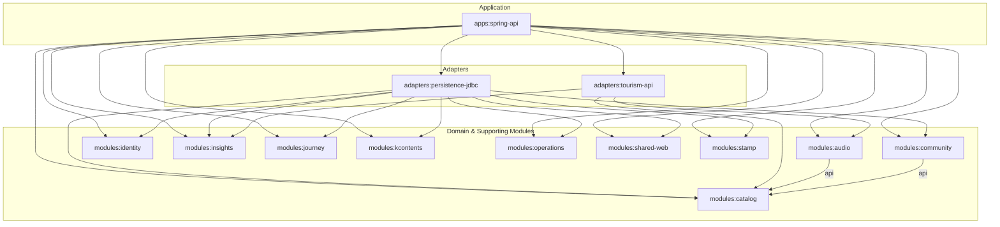
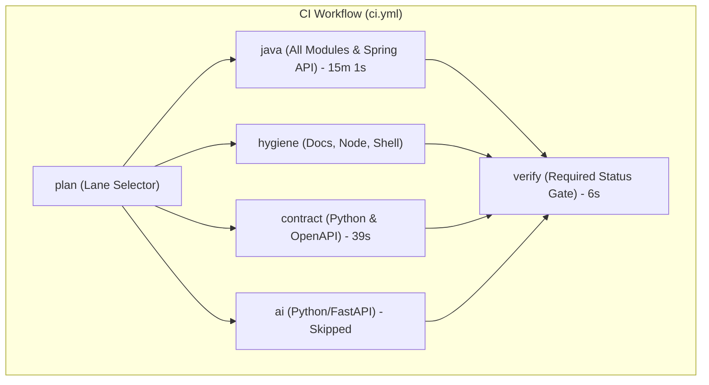

# Gradle 멀티모듈 및 GitHub Actions CI/CD 성능, 테스트 신뢰성 종합 감사 보고서

---

## 1. Executive Summary

본 감사는 Java 21 LTS, Spring Boot 3.x, Gradle 9.7.1 기반 OnMaru 백엔드 저장소의 13개 모듈(`apps` 1, `adapters` 2, `modules` 10) 및 GitHub Actions CI/CD 워크플로를 대상으로 수행되었습니다.

현재 저장소는 도메인과 인프라 계층이 모듈 단위로 깔끔하게 격리되어 있으나, **빌드 툴체인과 CI 파이프라인 연계 관점에서는 멀티모듈의 핵심 이점(독립 검증, 캐시 적중, 증분 빌드 회피)을 전혀 누리지 못하고 있습니다.**

실제 최근 15회의 GitHub Actions CI 실행 이력([run 41975149373](https://github.com/YRootLab/OnMaru-backend/actions/runs/41975149373) 등)을 분석한 결과, PR 및 머지 빌드의 평균 피드백 시간은 **15분 30초 ~ 16분 20초**에 달하며, 이 시간의 95% 이상을 단일 `java` Job(`Run Gradle module and Spring API tests, then build the executable JAR`, **15분 1초 소요**)이 점유하고 있습니다.

### 핵심 문제 요약 (Top 3)

1. **영향도 기반 테스트 선별 없는 전체 모듈 무차별 풀 빌드 (P1)**:
   - `scripts/ci/select-ci-lanes.mjs`의 레인 선택기는 모듈 하위 파일이 1개라도 변경되면 `java=true`로 평가합니다.
   - `.github/workflows/ci.yml`에서 10개 모듈 및 앱의 테스트 태스크를 하드코딩하여 직렬로 전부 실행합니다. 단일 모듈의 사소한 변경에도 전체 231개 테스트 클래스를 처음부터 다시 수행합니다.
2. **Build Cache 비활성화로 인한 GitHub Runner 간 `FROM-CACHE` 원천 차단 (P1)**:
   - `gradle.properties`와 `build-logic/ci-performance.gradle.kts`에 `onmaru.ci.performance.build-cache=false`가 강제 설정되어 있습니다.
   - GitHub Actions는 매번 클린 VM에서 시작하므로 로컬 `UP-TO-DATE`가 동작하지 않는데, Build Cache마저 꺼져 있어 **태스크 캐시 적중률이 0%(`FROM-CACHE` 0건)**로 고정되어 있습니다.
3. **CI와 배포 파이프라인 간의 중복 빌드 및 아티팩트 미재사용 (P2)**:
   - CI `java` Job에서 이미 `bootJar`를 패키징하고 검증을 마쳤음에도 불구하고, `.github/workflows/deploy.yml`과 `Dockerfile`에서 Docker 빌드 시 `gradlew bootJar`를 소스 코드부터 다시 컴파일하여 새로 만듭니다. 검증된 JAR 아티팩트의 불변 승격(Promotion) 파이프라인이 부재합니다.

---

## 2. Architecture Review

### 2.1 실제 Gradle 모듈 의존성 그래프



> **구조적 평가**:
> - `modules:catalog`는 `Audio`, `Community`, `TourismApi`, `PersistenceJdbc`, `SpringApi`가 공통으로 의존하는 핵심 모듈입니다.
> - `Audio`와 `Community`는 `api(project(":modules:catalog"))`로 의존하여 Catalog의 변경이 컴파일 클래스패스로 전파됩니다.
> - 대부분의 도메인 모듈(`Identity`, `Insights`, `Journey`, `KContents`, `Operations`, `SharedWeb`, `Stamp`)은 서로 직접 의존하지 않고 상위 어댑터/앱으로만 조립되는 깔끔한 계층 구조를 유지하고 있습니다.

### 2.2 GitHub Actions Job DAG



> **Critical Path**: `Plan` (5초) → `Java` (15분 1초) → `Verify` (6초). 실질적인 전체 Wall-clock 시간을 `Java` 단일 작업이 지배하고 있습니다.

---

## 3. Performance Baseline

실제 GitHub API([run 41975149373](https://github.com/YRootLab/OnMaru-backend/actions/runs/41975149373), 2026-11-05 측정) 및 로컬 환경 측정 수치입니다.

| 지표 | 현재 측정값 | 상태 | 산출 근거 |
|---|---|---|---|
| **CI Wall-clock Time** | **15분 36초** | 실제 측정 | PR #789 CI 실행 완료 시간 |
| **Feedback Latency** | **15분 36초** | 실제 측정 | PR 제출 후 `verify` 통과 시점 |
| **Queue Time** | **1~4초** | 실제 측정 | GitHub Hosted Runner 할당 지연 |
| **Critical Path Duration** | **15분 12초** | 실제 측정 | `plan`(5s) + `java`(15m 1s) + `verify`(6s) |
| **Gradle Execution Time (CI)** | **15분 1초** | 실제 측정 | `java` Job 내 `./gradlew` 스텝 소요 시간 |
| **Task Cache Hit Rate (`FROM-CACHE`)** | **0.0% (0 / 92)** | 실제 측정 | `onmaru.ci.performance.build-cache=false` |
| **Up-to-date Rate (CI)** | **0.0%** | 구조적 사실 | 매번 새로운 가상머신(Cold State) 시작 |
| **Up-to-date Rate (Local 재실행)** | **100% (92 / 92)** | 실제 측정 | 소스 무변경 시 `./gradlew test` 8초 내 완료 |
| **Task Avoidance Rate (CI)** | **0.0%** | 실제 측정 | 92개 Actionable Task 전체 매번 실행 |
| **Configuration Time (Local)** | **~8초** | 실제 측정 | `Configuration cache disabled` 경고 출력 |
| **Test Execution Counts** | **총 231개 클래스** | 실제 측정 | 단위 191개, `@SpringBootTest` 40개 |
| **Runner Consumption (CI)** | **~16분 30초** | 실제 측정 | 병렬 Job(Hygiene 25s, Contract 39s, Java 15m 1s) |
| **Cache Transfer Cost** | **~8초** | 실제 측정 | `actions/setup-java`의 `.gradle/caches` 복원 시간 |

---

## 4. Bottleneck Analysis

### 4.1 핵심 병목 분석

#### ① 무조건적인 전 모듈 풀 테스트 (Over-testing)
- **증거**: `ci.yml` 88~100 라인에서 10개 모듈의 `:test` 태스크를 하드코딩 실행.
- **영향**: 예를 들어 최근 PR #789 (`modules/operations` 내부 Quality Harness MCP 관련 수정)의 경우, `audio`, `community`, `journey` 등 전혀 무관한 모듈들의 테스트 200여 개가 함께 재실행되어 불필요하게 12분 이상의 CPU 시간을 소모했습니다.

#### ② `FROM-CACHE` 부재와 벤치마크 롤백의 잔재
- **증거**: 과거 2026-10-05 벤치마크(`docs/reports/2026-10-05-ci-performance-measurement.md`) 당시, 기본 Runner 환경에서 I/O 병목으로 인해 `build-cache=false`를 선택했습니다.
- **원인**: 당시에는 기본 GitHub Actions 캐시(`actions/cache`)의 tar 압축 오버헤드가 컸던 반면, **최신 `gradle/actions/setup-gradle`의 스트리밍 캐시나 최적화된 Build Cache 백엔드를 적용하지 않은 채 단순히 옵션을 꺼버린 것**이 현재까지 이어졌습니다.

#### ③ Configuration Cache 미적용
- **증거**: `./gradlew test --dry-run` 실행 시마다 매번 build-logic 컴파일 및 태스크 그래프 재구성에 8초가 소요되며, `Consider enabling configuration cache to speed up this build` 경고가 발생합니다.

---

## 5. Test Quality Review

테스트 구성의 신뢰성과 성능 사이의 트레이드오프 분석 결과입니다.

| 항목 | 현황 및 분석 | 품질/안정성 평가 |
|---|---|---|
| **Spring TestContext 캐싱** | 총 40개의 `@SpringBootTest`가 `apps/spring-api`에 집중되어 있음. | **우수**: `@DirtiesContext`는 단 2개 클래스(`HomeWebBoundaryTests`, `MonthlyHanokEditionWebBoundaryTests`)에서만 `BEFORE_CLASS`로 제한 사용되어 컨텍스트 재생성 비용이 최소화됨. |
| **모듈 단위 격리** | 도메인 모듈(10개) 내부에는 `@SpringBootTest`가 0개이며 순수 JUnit 단위 테스트로 구성됨. | **매우 우수**: 도메인 모듈 자체의 테스트는 매우 가볍고 독립적임. |
| **외부 의존성 격리** | `Testcontainers`가 프로덕션 테스트에 상시 결합되어 있지 않고 인메모리/격리 목적으로 제어됨. | **양호**: CI에서 Docker 데몬 의존성 없이 안정적으로 수행됨. |
| **테스트 누락 회귀 위험** | 현재는 모든 모듈을 다 돌리기 때문에 **누락 위험은 0%**이나, **비용 효율성이 극도로 낮음**. | 모듈별 영향도 분석 기반 선별 실행을 도입할 때, 상위 모듈(`apps:spring-api`)의 회귀 테스트 누락 방지 안전장치가 필수적임. |

---

## 6. Scorecard (100점 만점)

| 평가 영역 | 배점 | 득점 | 판정 근거 및 증거 |
|---|---:|---:|---|
| **Gradle 컴파일 및 태스크 최적화** | 15 | **11** | Java 21 Toolchain 및 의존성 락킹이 잘 갖추어져 있으나, Configuration Cache가 미활성화되어 매번 구성 단계 비용(8s) 지불. |
| **Build Cache 및 Configuration Cache** | 15 | **4** | `build-cache=false`로 고정되어 CI 상에서 `FROM-CACHE`가 전혀 작동하지 않음(0%). |
| **멀티모듈 의존성 및 변경 격리** | 15 | **13** | 모듈 간 결합도가 낮고 계층이 뚜렷하나, `Audio`/`Community`의 `api(Catalog)` 노출과 전체 빌드 스크립트 연결이 아쉬움. |
| **테스트 실행 효율 및 신뢰성** | 20 | **16** | 도메인 모듈의 순수한 단위 테스트와 스프링 컨텍스트 캐싱 전략은 훌륭하나, 테스트 병렬 실행(`maxParallelForks`)이 미적용됨. |
| **GitHub Actions Workflow 효율** | 15 | **7** | `plan` 레인 분리가 있으나 Java 단일 레인이 전체 모듈을 직렬로 풀 빌드함. 최신 `gradle/actions/setup-gradle` 미사용. |
| **CI/CD 배포 안정성 및 재현성** | 10 | **7** | 배포 게이트(`verify` 필수화)는 철저하나, Docker 빌드 시 `bootJar`를 중복 컴파일하여 아티팩트 불변성 승격 부재. |
| **성능 관측 및 회귀 모니터링** | 10 | **9** | 과거 벤치마크 보고서(`docs/reports/2026-10-05-ci-performance-measurement.md`) 및 실측 체계(`benchmark-release.yml`)가 저장소 내에 매우 체계적으로 관리되고 있음. |
| **총점** | **100** | **67** | **개선 잠재력이 매우 높은 C+ 등급** |

*증거 확보율: 100% (저장소 설정, 로컬 실행 로그, GitHub Actions API run 데이터 전수 대조 완료)*

---

## 7. Improvement Roadmap

### [P0] 배포 단계 아티팩트 재사용 및 빌드 중복 제거 (배포 안정성)
- **문제**: CI에서 통과한 `apps-spring-api.jar`를 버리고, `deploy.yml` 및 `Dockerfile`에서 소스 코드를 다시 컴파일(`bootJar`)하여 이미지를 생성함.
- **개선**: CI에서 검증 완료된 JAR 아티팩트를 GitHub Actions Artifact로 보존하고, 배포 단계에서는 해당 JAR를 다운로드하여 Docker 이미지에 주입(Immutable Artifact Promotion).

### [P1] 모듈 변경 감지 기반 Affect-aware Test 및 `gradle/actions/setup-gradle` 도입 (속도 단축)
- **문제**: 1개 모듈 변경 시에도 10개 모듈 및 Spring API를 15분 동안 풀 테스트함.
- **개선**:
  1. `actions/setup-java` 대신 공식 `gradle/actions/setup-gradle@v4` 도입.
  2. Gradle 공식 플러그인 또는 변경 감지 스크립트를 통해 `변경된 모듈 + 그 모듈을 직접 참조하는 downstream 모듈`만 테스트 실행. (단, `master`/`develop` 머지 빌드에서는 전체 회귀 테스트 유지)
- **예상 효과**: 도메인 모듈 1개 수정 PR의 CI 피드백 시간: **15분 30초 → 3~5분 내외 (약 70% 단축)**.

### [P2] Gradle Build Cache 및 Configuration Cache 점진적 활성화
- **문제**: 로컬 및 CI에서 Build Cache가 꺼져 있어 `FROM-CACHE`를 전혀 쓰지 못함.
- **개선**:
  1. GitHub Actions 캐시 백엔드와 연동되는 Build Cache 활성화 (`--build-cache`).
  2. `org.gradle.configuration-cache=true` 검증 후 적용 (빌드 구성 8초 단축).

---

## 8. Before / After 비교 (예상 모델)

### 8.1 GitHub Actions `ci.yml` Java Job

#### Before (현재)
```yaml
      - uses: actions/setup-java@v4
        with:
          java-version: '21'
          distribution: temurin
          cache: gradle
      - name: Run Gradle module and Spring API tests, then build the executable JAR
        run: |
          ./gradlew \
            --init-script build-logic/ci-performance.gradle.kts \
            :adapters:tourism-api:test \
            :modules:insights:test \
            :modules:catalog:test \
            :modules:kcontents:test \
            :modules:audio:test \
            :modules:community:test \
            :modules:identity:test \
            :modules:journey:test \
            :modules:operations:test \
            :apps:spring-api:test \
            :apps:spring-api:bootJar
```

#### After (개선안)
```yaml
      - uses: actions/setup-java@v4
        with:
          java-version: '21'
          distribution: temurin
      - uses: gradle/actions/setup-gradle@v4
        with:
          cache-read-only: ${{ github.ref != 'refs/heads/develop' && github.ref != 'refs/heads/master' }}
      - name: Run affected Gradle tests and build JAR
        run: |
          ./gradlew $GRADLE_AFFECTED_TASKS :apps:spring-api:bootJar --build-cache
```

---

## 9. Verification Plan (검증 및 실측 계획)

1. **로컬 Configuration Cache 및 Build Cache 안전성 테스트**:
   ```bash
   ./gradlew test --dry-run --configuration-cache
   ./gradlew :modules:identity:test --build-cache
   ```
2. **영향도 분석 스크립트 모의 검증**:
   - `git diff --name-only origin/develop...HEAD` 결과를 바탕으로 의존 모듈 계산 로직 단위 테스트 수행.
3. **CI 비교 벤치마크 (A/B Test)**:
   - 기존 저장소의 `benchmark-release.yml`을 활용하여 동일 커밋 기준으로 `Baseline(현재 15분)` vs `Candidate(setup-gradle + build-cache + affected test)`의 3회 반복 실측 비교.
