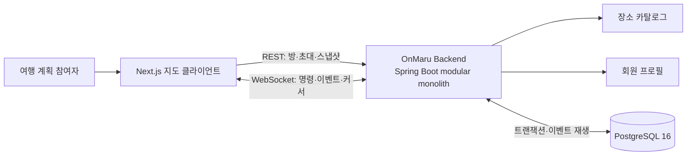
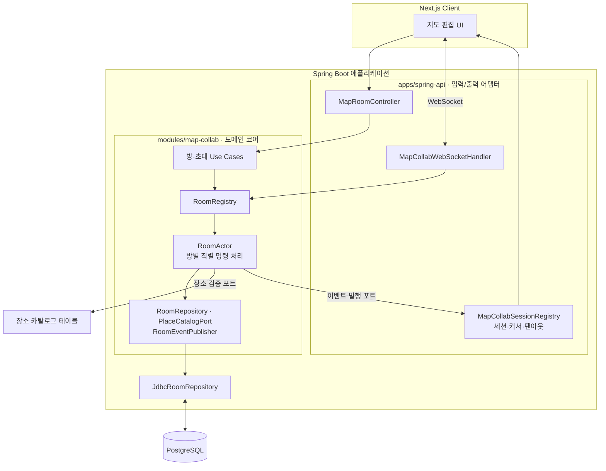
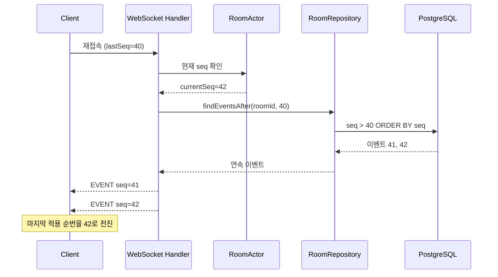
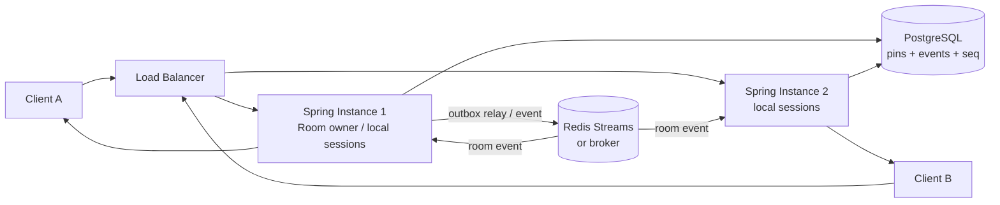

# OnMaru 지도 공동 편집: WebSocket부터 C4, 멱등성, 다중 인스턴스 확장까지

> 대상 구현: Issue [#825](https://github.com/YRootLab/OnMaru-backend/issues/825), 구현 커밋 `297c6387`, 현재 브랜치 `feature/825-map-collab-backend`
> 기술 기준: Spring Boot 3.4 · Java 21 · WebSocket · PostgreSQL 16 · JDBC · modular monolith
> 범위: 현재 구현과 그 설계의 의도, 그리고 Redis·다중 인스턴스로 확장할 때 보존해야 할 경계

## 함께 지도를 편집할 때 진짜 어려운 것은 화면을 갱신하는 일이 아니었습니다

여러 사람이 같은 지도에 장소를 추가하면, 한 사람의 화면에는 핀이 보이는데 다른 사람의 화면에는 늦게 나타나는 순간이 생길 수 있습니다. 연결이 끊겼다가 다시 붙은 사용자는 중간 변경을 놓칠 수 있고, 요청은 서버에서 처리됐는데 응답만 유실되면 같은 핀이 두 번 생길 수도 있습니다. 여기에 잘못된 좌표를 보내거나 두 사람이 동시에 같은 장소를 추가하는 경우까지 생각하면, 공동 편집은 단순한 실시간 브로드캐스트와는 조금 다른 문제라는 걸 알게 됩니다.

이번 브랜치의 핵심은 WebSocket을 붙인 데서 끝나지 않습니다. 방 안의 변경에 순서를 부여하고, 영속 데이터와 실시간 메시지가 서로 다른 진실을 말하지 않게 하며, 재연결과 재시도까지 같은 프로토콜 안에서 다루는 구조를 만들었습니다. 기존 Liveblocks에 맡겨져 있던 실시간 상태를 OnMaru가 직접 소유하면서, 여행 장소 카탈로그와 PostgreSQL 이벤트 이력에 공동 편집을 연결한 것이 이 기능의 가장 큰 제품적·기술적 변화입니다.

이 글에서는 C4의 시스템 컨텍스트부터 컴포넌트와 런타임 시퀀스까지 내려가며 구조를 살펴봅니다. 이어서 `opId` 멱등성, 방별 `seq`, DB 트랜잭션과 브로드캐스트 순서가 어떤 정합성을 만드는지 설명하고, 현재 단일 인스턴스 전제를 Redis·다중 인스턴스로 옮길 때 어떤 점을 유지해야 하는지도 구분해 보겠습니다.

## 공동 편집의 상태를 OnMaru가 직접 소유하게 된 배경

이 기능은 기존 실시간 협업 SaaS인 Liveblocks를 대체하고, 방·멤버·초대·핀 변경을 OnMaru 백엔드의 도메인과 연결하는 작업으로 시작했습니다. 외부 룸에만 남는 상태는 서비스의 장소 카탈로그 검증, 감사 가능한 변경 이력, 이후 여정(Journey)으로 이어지는 도메인 통합을 어렵게 만들었습니다. SaaS의 사용량과 비용이 커질 때 데이터와 정책의 소유권도 외부 시스템에 묶이는 문제가 있었습니다.

그래서 현재 구현은 핀을 서버가 검증한 장소 카탈로그 데이터로만 만들고, 변경을 PostgreSQL에 먼저 기록합니다. WebSocket은 사용자에게 빠르게 변경을 전달하는 통로이며, 권위 있는 상태와 방 내 순서는 DB의 핀·이벤트·`last_event_seq`로 복구할 수 있게 설계했습니다. 커서처럼 빈번하지만 일시적인 정보는 메모리에서 처리하고 저장하지 않습니다.

이 구분은 설계의 trade-off를 설명해 줍니다. 현재는 방별 메모리 Actor와 프로세스 내부 WebSocket 세션을 사용해 구현과 운영 부담을 낮췄습니다. 그 대신 방의 명령 소유권과 세션 팬아웃이 한 애플리케이션 인스턴스 안에 있다는 경계가 명확하며, 다중 인스턴스로 갈 때는 이 경계를 분산 소유권 모델로 바꿔야 합니다.

## C4 시스템 컨텍스트에서 실시간 공동 편집의 경계를 본다

시스템 컨텍스트에서 사용자는 Next.js 지도 화면에서 방을 만들고, 초대 링크로 동료를 초대하고, 핀과 커서를 함께 편집합니다. 브라우저는 방 메타데이터와 스냅샷에는 REST를, 실시간 핀 명령·이벤트·커서에는 WebSocket을 사용합니다. 백엔드는 장소 카탈로그, 회원 정보, PostgreSQL을 통해 OnMaru의 기존 도메인 및 영속 계층과 연결됩니다.



*그림: 브라우저와 OnMaru 도메인 사이에서 REST와 WebSocket이 맡는 역할.*

시스템 컨텍스트에서 중요한 점은 클라이언트가 장소의 이름이나 좌표를 권위 있는 값으로 결정하지 않는다는 것입니다. 핀 추가 명령은 `placeId`를 전달하고, 서버가 `PlaceCatalogPort`로 검증된 장소 이름과 좌표를 조회합니다. 이 계약 덕분에 다른 사용자가 임의의 좌표를 보내 지도의 공동 상태를 오염시키는 경로를 줄이고, 핀을 OnMaru 장소 도메인과 안정적으로 연결할 수 있습니다.

## 컨테이너와 컴포넌트는 실시간 어댑터와 도메인 코어를 나눈다

컨테이너 관점에서 현재 런타임은 Spring API 애플리케이션과 PostgreSQL로 구성됩니다. 애플리케이션 안에서 REST 컨트롤러는 방 생성·초대·조회·스냅샷을 처리하고, WebSocket 핸들러는 연결 수립과 메시지 계약을 처리합니다. `modules/map-collab`은 방·핀·이벤트의 도메인과 포트를 소유하며, JDBC 구현체와 WebSocket 세션 레지스트리는 외부 어댑터로 남습니다.



*그림: transport와 인메모리 연결 관리는 바깥에, 변경 규칙은 `map-collab` 코어에 둔 C4 컨테이너·컴포넌트 뷰.*

`RoomActor`는 방별 활성 핀 인덱스와 마지막 이벤트 순번을 가지고 있습니다. `RoomRegistry`는 `roomId`에서 Actor를 찾아주며, Actor는 저장소·장소 카탈로그·이벤트 발행자를 포트로만 바라봅니다. 따라서 도메인 코어는 Spring WebSocket API나 JDBC 클래스에 직접 묶이지 않습니다. 이 경계는 Redis를 붙인다고 도메인 규칙까지 Redis 자료구조로 옮길 필요가 없게 해주는 확장 지점입니다.

다만 “포트가 있으니 다중 인스턴스는 어댑터만 교체하면 된다”라고 해석하면 곤란합니다. 현재 `RoomRegistry`의 Actor map과 `MapCollabSessionRegistry`의 세션 map은 JVM 내부 상태입니다. 인스턴스가 둘이면 같은 방의 Actor가 양쪽에 각각 생길 수 있고, 각 프로세스가 서로의 WebSocket 세션을 볼 수 없습니다. 인터페이스는 교체 지점을 제공하지만 분산 잠금, 방 소유권, 메시지 전달 보장까지 자동으로 제공하지는 않습니다.

## 핀 변경은 하나의 방 안에서 직렬화되고 DB 커밋 뒤에 공개된다

공동 편집에서 동시에 여러 명이 같은 방을 수정하면 “어느 핀이 먼저 추가되었는가”에 공통된 답이 있어야 합니다. 현재 `RoomActor.addPin`과 `removePin`은 동기화된 방 단위 메서드로 실행됩니다. 한 Actor 안에서 명령 하나가 끝난 뒤 다음 명령이 처리되므로 `lastEventSeq + 1`로 계산한 다음 `seq`가 방 안에서 단조 증가합니다.

핀 추가의 핵심 경로는 다음과 같습니다. 먼저 만료와 `opId`를 확인하고, 장소 카탈로그를 조회한 뒤 중복 장소와 핀 상한을 검증합니다. 그 다음 저장소가 핀 행, 이벤트 행, 방의 `last_event_seq`를 한 DB 트랜잭션으로 갱신합니다. 저장소 호출이 성공한 뒤에만 Actor의 메모리 인덱스를 바꾸고 이벤트를 브로드캐스트합니다.

```text
PIN_ADD(opId, placeId)
  → opId 재시도 여부 확인
  → 서버 카탈로그에서 장소 조회
  → 같은 방의 활성 중복·핀 상한 검증
  → PostgreSQL 트랜잭션
      ├─ map_room_pins INSERT
      ├─ map_room_events INSERT (seq = last_event_seq + 1)
      └─ map_rooms.last_event_seq UPDATE
  → 트랜잭션 커밋
  → RoomActor 인메모리 상태 반영
  → RoomEventPublisher 브로드캐스트
  → 요청자 ACK
```

*그림: DB가 성공한 뒤에만 메모리 상태와 참여자 화면에 새 핀을 공개하는 write-through 순서.*

이 순서가 만드는 보장은 “DB와 브라우저 네트워크가 분산 트랜잭션처럼 한꺼번에 성공한다”가 아닙니다. DB는 변경의 영속 원장이고, 메모리와 WebSocket은 그 원장을 빠르게 반영하는 층입니다. DB 트랜잭션이 실패하면 Actor가 핀과 순번을 바꾸지 않으므로 실패한 변경이 다른 참여자에게 먼저 노출되지 않습니다. 커밋 후 브로드캐스트가 실패하거나 연결이 끊기는 경우는 별도 문제이며, 연결 복구 시 이벤트 이력을 재생해 따라잡게 합니다.

세션 레지스트리는 핀 이벤트와 별도로 커서 변경을 80ms 간격으로 모읍니다. 방과 사용자별 최신 좌표만 유지했다가 `CURSORS` 메시지 배열로 합쳐 보내므로 마우스가 움직일 때마다 DB 쓰기나 개별 브로드캐스트를 만들지 않습니다. 메시지 크기는 4KB로 제한하고, 느린 소비자의 outbound 대기량은 256개까지 허용한 뒤 초과 연결을 `SLOW_CONSUMER`로 닫습니다. 즉 지속되어야 하는 핀 변경과 최신 값만 의미 있는 커서 위치에 서로 다른 전송 정책을 적용했습니다.

## `opId`는 재전송을 새 변경으로 만들지 않는다

네트워크에서는 서버가 DB 커밋을 끝낸 뒤 ACK가 클라이언트에 도착하기 전에 연결이 끊길 수 있습니다. 클라이언트 입장에서는 명령이 성공했는지 실패했는지 모호하므로 같은 명령을 다시 보낼 수밖에 없습니다. 이때 요청마다 새 핀이 생기면 재시도는 중복 편집이 됩니다.

클라이언트는 하나의 논리 연산마다 UUID `opId`를 만들고 재전송할 때 동일한 값을 유지합니다. 서버는 먼저 Actor의 최근 처리 결과를 확인하고, 없으면 PostgreSQL의 `(room_id, client_op_id)` 유니크 이벤트를 확인합니다. 같은 `opId`와 같은 연산 내용이면 원래 `seq`와 결과를 replay로 반환하며, 같은 `opId`를 다른 장소나 다른 종류의 연산에 재사용하면 `OP_CONFLICT`로 거절합니다.

| 계층 | 중복 방지 장치 | 맡는 책임 |
|---|---|---|
| WebSocket 계약 | 동일 논리 요청에 동일 `opId` | 재연결·타임아웃 재시도에서 연산 식별 유지 |
| RoomActor 메모리 | 최근 `opId` 결과 캐시 | 활성 프로세스 안에서 빠른 재시도 응답 |
| PostgreSQL | `(room_id, client_op_id)` 부분 유니크 인덱스와 이벤트 조회 | Actor 재생성 뒤에도 중복 커밋 방지 |
| 도메인 제약 | `(room_id, place_id)` 활성 핀 유니크 인덱스 | 서로 다른 `opId`를 쓴 동시 중복 핀도 최종 차단 |

여기서 “멱등”은 모든 요청에 대한 무조건 성공 응답을 뜻하지 않습니다. 같은 키에 같은 의미의 명령을 반복하면 한 번의 결과를 다시 받지만, 동일 키를 다른 내용에 재사용하면 충돌입니다. 그리고 서버의 처리 결과가 DB에 남아 있기 때문에 메모리 캐시가 사라져도 멱등성의 핵심이 유지됩니다. 메모리는 성능 경로이고, DB 유니크 제약과 이벤트 행이 중복 방지의 영속 경계입니다.

서로 다른 `opId`로 동일 `placeId`를 거의 동시에 추가하는 경우도 고려해야 합니다. 현재 단일 인스턴스에서는 Actor 직렬화가 먼저 순서를 정하고, DB의 활성 핀 부분 유니크 인덱스가 최종 불변식을 지킵니다. 다중 인스턴스에서는 두 Actor가 각자의 메모리에서 “아직 없다”고 판단할 수 있으므로 DB 제약 위반을 도메인 오류로 매핑하고, 해당 Actor 상태를 재조회·복구해야 합니다. 프로세스 메모리 검증만으로 분산 동시성을 막을 수는 없습니다.

## `seq`와 이벤트 이력은 순서와 재연결을 함께 다룬다

각 방의 `seq`는 실시간 변경의 순서를 나타내는 논리 시계입니다. 핀 추가 이벤트가 `seq=41`이고 다음 제거 이벤트가 `seq=42`라면, 클라이언트는 벽시계의 시각을 비교하지 않고 이벤트 순서를 재구성할 수 있습니다. 핀의 `added_seq`도 이 순서를 사용하므로 지도 경로의 핀 순서가 이벤트 순서와 같은 기준을 공유합니다.

클라이언트는 마지막으로 적용한 `lastSeq`를 재연결 때 보냅니다. 서버는 현재 `seq`보다 큰 값을 보내거나 음수인 값은 거절하고, DB에서 그 이후 이벤트를 읽어 연속성을 검사합니다. 중간 번호가 빠져 있으면 일부 이벤트만 조용히 보내는 대신 `RESYNC_REQUIRED`를 응답해 전체 스냅샷을 다시 받도록 유도합니다. 이벤트 replay는 transport의 일시적 전달 실패를 저장된 기록으로 보완하는 방식입니다.



*그림: 마지막 순번 이후의 이벤트가 연속일 때 DB 이력으로 연결을 복구하는 흐름.*

이 구조는 WebSocket 전달이 exactly-once라고 가정하지 않습니다. 실시간 이벤트는 중복 또는 누락 가능성을 네트워크 경계에서 가진다고 보고, `seq`로 중복을 식별하고 `lastSeq`와 replay로 누락을 복구합니다. 스냅샷과 replay의 경계를 다룰 때도 클라이언트는 적용한 가장 큰 `seq`를 추적할 수 있습니다. 이벤트 보존 정책이 향후 도입되어 요청한 순번의 이력이 사라진다면, 지금처럼 연속성을 검증하고 스냅샷으로 전환하는 규칙이 특히 중요해집니다.

## 이 구현이 살린 장점은 도메인 일관성과 단순한 복구 경로에 있다

첫 번째 장점은 장소 데이터의 신뢰 경계입니다. 클라이언트가 보낸 좌표를 받아들이지 않고 장소 ID만 입력으로 받으므로, 모든 참여자가 같은 카탈로그 레코드를 공유합니다. 지도 선의 순서도 DB 이벤트 `seq`와 핀 `added_seq`를 통해 결정되며, 동시 편집에서 화면마다 다른 순서가 만들어지는 위험을 줄였습니다.

두 번째는 외부 실시간 공급자에 갇히지 않는 소유권입니다. 룸·멤버·초대·핀·이벤트가 OnMaru의 데이터 모델과 API 계약에 들어왔기 때문에, 공동 편집 이력을 이후 여정 저장이나 감사 흐름에 연결할 수 있습니다. SaaS 사용량에 따라 별도 실시간 제품 비용이 증가하는 구조도 제거했습니다. 비용 절감 규모 자체는 이 브랜치 코드만으로 산출할 수 없으므로 정량 절감액으로 표현하지 않는 편이 정확합니다.

세 번째는 현재 요구에 맞춘 인프라 절제입니다. 핀 변경은 사람의 속도로 발생하고, 고빈도 커서는 지속 데이터가 아닙니다. 그래서 별도 Redis 상태 저장소를 당장 도입하는 대신 PostgreSQL을 핀 변경의 영속 원장으로 두고, 커서와 세션은 단일 프로세스 메모리에서 다룹니다. `RoomRepository`, `RoomEventPublisher`, `RoomSessionTracker` 경계는 현재 구현 복잡도를 낮추면서 추후 교체 가능한 지점을 보존합니다.

마지막으로 복구가 DB에 의해 설명됩니다. 프로세스가 재시작되면 RoomActor는 방의 `last_event_seq`와 활성 핀을 다시 읽을 수 있습니다. 재연결된 브라우저는 마지막 순번 이후의 이벤트를 replay하거나 필요한 경우 스냅샷 재동기화를 받습니다. 즉 메모리는 빠른 실행을 위해 존재하지만, 핵심 핀 상태를 유일한 복구 원장으로 들고 있지는 않습니다.

## Redis와 다중 인스턴스는 브로드캐스트보다 방 소유권부터 설계해야 한다

현재 구현을 여러 인스턴스에 그대로 띄우면 같은 `roomId`에 대해 각 프로세스가 독립된 `RoomActor`와 WebSocket 세션 목록을 가질 수 있습니다. 인스턴스 A에서 핀을 추가하면 A의 클라이언트는 이벤트를 받지만 B에 붙은 참여자는 받지 못할 수 있습니다. 더 심각하게는 A와 B가 동시에 서로 다른 명령에 같은 `nextSeq`를 계산할 수 있습니다. 따라서 Redis Pub/Sub만 연결해 메시지를 복제해도 직렬화와 DB 순번 충돌 문제가 해결되는 것은 아닙니다.

확장 단계에서는 먼저 각 방에 대해 쓰기 명령을 처리할 단일 소유자를 정해야 합니다. 선택지는 로드밸런서의 방 단위 sticky routing, Redis 기반 lease/partition owner, 또는 DB의 원자적 `last_event_seq` 갱신과 충돌 후 Actor 재조정입니다. 현재 ADR-0020은 우선 단일 인스턴스를 목표로 하고 있으며, 검토 조건으로 다중 인스턴스 운영 필요성과 nginx URI 해시 라우팅 및 Redis Streams를 언급합니다. 이는 현재 구현 완료 상태와 미래 설계 제안을 구분해서 읽어야 하는 부분입니다.

| 확장 접근 | 제공하는 것 | 추가로 해결해야 할 것 |
|---|---|---|
| 방 단위 sticky routing | 한 방의 연결과 명령을 같은 인스턴스로 보낼 가능성 | 재배포·장애 시 라우팅 변경, 장기 연결 재수립, 교차 인스턴스 운영 상태 |
| Redis Pub/Sub | 발행 시점 구독자에게 낮은 지연으로 팬아웃 | 메시지 유실 복구, 구독 재시작, 방 단일 쓰기 소유권, 중복 전달 대응 |
| Redis Streams | 소비 위치와 보존된 이벤트 스트림 | DB 이벤트와 스트림 발행의 원자성, consumer group 설계, 재처리 및 보존 정책 |
| PostgreSQL transactional outbox + relay | 도메인 트랜잭션과 발행 의도의 원자적 기록 | relay 지연·중복 처리, 이벤트 스키마 버전, broker 운영과 재생 설계 |

인스턴스 간 이벤트 전달이 필요해지면, PostgreSQL 트랜잭션이 성공한 뒤 바로 Redis에 publish하는 방식에는 crash window가 있습니다. DB 커밋 직후 프로세스가 죽으면 핀과 이벤트는 남지만 Redis 메시지는 발행되지 않습니다. V058 주석은 이벤트 테이블이 추후 CDC 발행에 쓰일 수 있음을 적고 있지만, 현재 구현에 transactional outbox relay가 있다고 말할 수는 없습니다. 확장 시에는 이미 트랜잭션에 포함되는 `map_room_events`를 outbox 원천으로 활용하거나 별도 outbox 테이블을 두고, broker 전송은 재시도 가능한 비동기 relay로 처리하는 접근이 견고합니다.

broker 전달은 보통 at-least-once로 설계하고, 소비자는 `roomId + seq` 또는 event ID로 중복을 제거해야 합니다. 클라이언트 역시 `seq <= lastAppliedSeq`인 이벤트는 다시 적용하지 않고, 순번이 건너뛰면 replay나 snapshot을 요청할 수 있어야 합니다. Redis Pub/Sub은 낮은 지연의 휘발성 팬아웃에는 적합하지만 메시지 보관과 재생을 제공하지 않으므로 PostgreSQL 이벤트 이력 또는 Streams 같은 영속 스트림을 복구 경로로 명확히 선택해야 합니다.

커서와 presence는 핀 이벤트와 다른 급의 데이터입니다. 커서는 최신 값만 의미 있으므로 인스턴스별 80ms 병합 후 Redis Pub/Sub로 fan-out할 수 있고, 유실되어도 다음 커서 값이 상태를 덮어씁니다. Presence도 연결 객체 자체를 공유할 수는 없으므로, 분산 집계가 필요하면 인스턴스별 연결 수나 lease TTL을 관리해 한 사용자가 다른 인스턴스에 남긴 연결을 잘못 offline 처리하지 않도록 해야 합니다. WebSocket session 객체는 JVM 경계를 넘겨 저장할 수 없으며, 각 인스턴스가 자기 연결에 전달하는 local delivery가 유지되어야 합니다.

## C4의 런타임 흐름을 확장 관점에서 다시 보면 경계가 선명해진다

현재 구성에서는 RoomActor가 방의 직렬화, DB 쓰기 호출, 로컬 브로드캐스트를 연결합니다. 다중 인스턴스에서는 이 중 “직렬화”를 방 소유권 계층으로 분명히 끌어올리고, “브로드캐스트”를 인스턴스 간 broker fan-out과 각 인스턴스의 로컬 WebSocket 전송으로 나누게 됩니다. PostgreSQL은 여전히 권위 있는 핀 상태와 재생 가능한 이벤트 이력을 보유하고, Redis는 연결 위치·낮은 지연 팬아웃·필요하다면 lease를 제공할 수 있습니다.



*그림: 확장 단계에서도 DB 원장, 방 쓰기 소유권, broker 팬아웃, 인스턴스별 세션 전송을 분리해야 한다.*

이 그림은 다음 배포의 확정 아키텍처가 아니라, 지금 보존한 경계를 기준으로 한 확장 모델입니다. 다중 인스턴스로 이동할 때 Redis를 도입하는 것만으로 해결됐다고 판단하지 않고, 어떤 컴포넌트가 한 방의 순번을 발급하는지, 커밋한 이벤트를 어떤 방식으로 누락 없이 전달하는지, 재연결 시 어느 로그를 기준으로 복구하는지 각각 검증해야 합니다.

## 구현이 보장하는 범위와 다음 검증 신호를 구분한다

이번 브랜치에는 방·초대·핀 REST 경로, WebSocket 메시지 계약, RoomActor의 핀 추가·삭제와 `opId` 재처리, 세션 및 커서 집계, PostgreSQL 스키마가 구현되어 있습니다. RoomActor 테스트는 동일 `opId` 재시도, 다른 payload로의 재사용 충돌, 중복 장소, DB 실패 시 메모리 불변, 제거 후 재추가 같은 경계를 확인합니다. 별도의 3명 클라이언트 실시간 핀 동기화 통합 테스트 커밋(`ecba2b35`)도 이 브랜치에 포함되어 있습니다.

문서상 인수 기준에는 방당 인원·핀·초대·세션 상한, 80ms 커서 병합, 만료 처리 등이 정리돼 있습니다. 반면 현재 상태를 과장하지 않기 위해 아래 두 항목은 구분해야 합니다. `MapCollabWebSocketHandler`의 heartbeat 주석은 주기와 timeout 검사만 보여 주며 실제 ping 전송·timeout close가 완성됐다고 증명하지 않습니다. 또한 별도 HTTP/DB를 포함한 운영 환경 부하 자료 없이 “100ms 이내” 같은 SLO를 보장으로 단정할 수 없습니다. 이런 부분은 운영 측정과 코드 경로를 추가 확인한 뒤 목표와 달성 사실을 구분해 기록하는 편이 좋겠습니다.

현재의 핵심 보장은 단일 애플리케이션 인스턴스에서 한 방의 명령을 하나의 Actor가 직렬 처리하고, PostgreSQL 커밋 후에 메모리 반영과 이벤트 발행을 한다는 것입니다. 다중 인스턴스 보장은 아직 아닙니다. 다음 확장의 완료 신호는 Redis가 떠 있다는 사실이 아니라, 동시 방 명령이 단일한 `seq`를 얻고, 커밋된 모든 이벤트가 인스턴스 경계를 넘어 전달되며, 재연결 replay가 유실 구간을 검출하고, 인스턴스 재시작 뒤에도 핀 상태와 순번이 복구되는 통합 검증입니다.

## 맺으며: 실시간 편집은 메시지보다 일관된 상태 모델에서 시작했다

이번 공동 편집 기능을 구현하면서 다시 느낀 점은 실시간 기능의 핵심이 빠른 전송 자체에 있지 않다는 것입니다. 누가 어떤 장소를 선택했는지 서버가 검증하고, 변경이 어느 순서로 승인됐는지 기록하고, 같은 요청을 다시 받아도 결과가 달라지지 않으며, 끊겼던 클라이언트가 그 순서로 돌아올 수 있어야 실시간 UX가 제품의 실제 상태와 이어집니다.

현재 구조는 단일 인스턴스라는 현실적인 출발점 위에서 그 기반을 만들었습니다. PostgreSQL 이벤트 이력과 방별 Actor는 순서와 멱등성을, 카탈로그 검증은 도메인 신뢰를, WebSocket 세션 레지스트리는 낮은 지연의 로컬 fan-out을 맡습니다. 이후 Redis와 여러 인스턴스를 도입할 때도 이 책임들을 한꺼번에 섞기보다 방 소유권, 이벤트 전달, 커서·presence fan-out을 하나씩 분리해 검증하면, 지금 만든 단순함의 장점을 꽤 오래 가져갈 수 있을 것 같습니다.

## 구현과 계약을 더 읽어볼 자료

- [Issue #825 — 지도 공동 편집 백엔드](https://github.com/YRootLab/OnMaru-backend/issues/825)
- [지도 공동 편집 구현 커밋](https://github.com/YRootLab/OnMaru-backend/commit/297c6387)
- [3명 클라이언트 실시간 동기화 테스트 커밋](https://github.com/YRootLab/OnMaru-backend/commit/ecba2b35)
- [ADR-0020 — 지도 공동 편집 방 상태는 Spring 메모리에서 단일 소유자로 처리하고 핀은 PostgreSQL에 write-through 한다](https://github.com/YRootLab/OnMaru-backend/blob/develop/docs/decisions/0020-map-collab-room-state-in-memory.md)
- [REST 및 WebSocket 계약](https://github.com/YRootLab/OnMaru-backend/blob/develop/docs/contracts/map-collab-api-spec.md)
- [엔지니어링 보고서](https://github.com/YRootLab/OnMaru-backend/blob/develop/docs/reports/map-collab-engineering-report.md)
